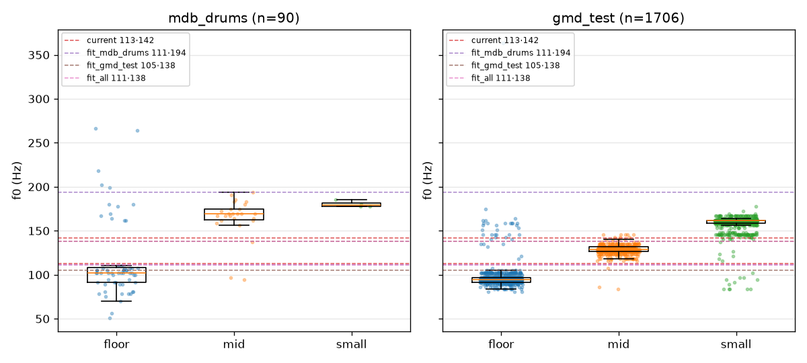

# 탐 음높이 경계 재설정 분석 (S15P31A307-163)

측정일 2026-10-26 · 모델 ADTOF + 드럼 킷 분리(`adtof_drumsep`) · 입력 정답 드럼 트랙 · 로컬 RTX 4070

## 결론

- 탐 3종을 나누는 고정 음높이 경계(113·142Hz)는 **그대로 둠**. 실제 밴드 녹음(MDB 23곡)은 드럼 세트마다 탐 음높이가 달라서, 전자 드럼(GMD)을 깎지 않고 MDB를 올리는 고정 경계가 없음
- 대신 탐 음높이를 재는 구간을 타격 직후 **80ms → 120ms**로 늘림. GMD 탐 F1 0.876 → 0.880, MDB 0.175 → 0.213. 심벌 판정 구간은 80ms 그대로 둠(`cymbal_window_ms`, 늘리면 크래시가 조금 떨어짐)
- MDB 탐이 여전히 낮은 이유는 경계가 아니라 **드럼 세트별 음높이 차이**와 **탐이 아닌 소리를 탐으로 잡은 타격 217개**임. 전자는 곡마다 기준을 잡는 방식(S15P31A307-164), 후자는 규칙 밖(모델)

## 정답 탐의 음높이

탐 정답 타격마다 드럼 킷 분리의 toms 트랙에서 타격 직후 80ms 구간의 가장 큰 주파수 봉우리(50~400Hz)를 잼. 채보 규칙이 쓰는 값과 같음.

| 묶음 | 탐 | 타격 수 | 중앙값 Hz | 사분위 | 곡 수 | 곡별 중앙값 편차 | 곡별 중앙값 범위 |
| --- | --- | --- | --- | --- | --- | --- | --- |
| GMD 45개 | 플로어탐 | 674 | 94 | 92~97 | 13 | 7.8 | 83~120 |
| GMD 45개 | 미드탐 | 451 | 129 | 127~132 | 11 | 14.2 | 83~137 |
| GMD 45개 | 스몰탐 | 581 | 162 | 159~162 | 15 | 20.0 | 83~168 |
| MDB 23곡 | 플로어탐 | 60 | 102 | 92~108 | 6 | 44.5 | 78~201 |
| MDB 23곡 | 미드탐 | 26 | 170 | 162~175 | 3 | 38.2 | 96~183 |
| MDB 23곡 | 스몰탐 | 4 | 179 | 178~182 | 2 | 2.7 | 178~183 |



- GMD는 전자 드럼 한 종류라 탐 3종이 94·129·162Hz로 또렷이 갈림. 지금 경계 113·142Hz는 이 값에 맞춘 것
- MDB는 탐 정답이 90개(곡 7개)뿐이고 곡마다 다름. 플로어탐 중앙값이 Beatles 105, Grunge 78, FreeJazz 164, LatinJazz 201Hz. 한 곡의 플로어탐이 다른 곡의 미드탐보다 높음
- 즉 "플로어탐은 몇 Hz 아래"라는 고정 기준이 실제 녹음에는 성립하지 않음

MDB 곡별 중앙값 (Hz)

| 곡 | 플로어탐 | 미드탐 | 스몰탐 |
| --- | --- | --- | --- |
| MusicDelta_Beatles | 105 (30개) | | |
| MusicDelta_FreeJazz | 164 (3개) | 168 (20개) | |
| MusicDelta_FunkJazz | | | 178 (2개) |
| MusicDelta_FusionJazz | 162 (9개) | 183 (4개) | |
| MusicDelta_Grunge | 78 (12개) | | |
| MusicDelta_LatinJazz | 201 (2개) | | |
| MusicDelta_Punk | 92 (4개) | 96 (2개) | 183 (2개) |

## 고정 경계 후보 비교

경계 둘(아래·위)을 60~300Hz에서 1Hz 간격으로 훑어, 정답 음높이를 그 경계로 나눴을 때 정답 탐과 같은 비율(bandAcc)이 가장 높은 값을 고름. 실제 점수는 저장한 특징으로 규칙만 다시 돌려 잰 패드별 온셋 F1(50ms)임.

| 후보 | 경계 Hz | bandAcc MDB | bandAcc GMD | 탐 F1 GMD | 탐 F1 MDB | 탐 배정 정확도 GMD | 탐 배정 정확도 MDB |
| --- | --- | --- | --- | --- | --- | --- | --- |
| 지금 값 | 113·142 | 0.578 | 0.961 | 0.876 | 0.175 | 0.972 | 0.542 |
| MDB에 맞춤 | 111·194 | 0.789 | 0.638 | **0.588** | 0.240 | 0.655 | 0.746 |
| GMD에 맞춤 | 105·138 | 0.500 | 0.961 | 0.876 | 0.142 | 0.973 | 0.441 |
| 둘 절충 | 111·138 | 0.578 | 0.961 | 0.875 | 0.175 | 0.972 | 0.542 |
| GMD 0.95 이상 조건에서 MDB 최대 | 111·138 | 0.578 | 0.961 | 0.875 | 0.175 | 0.972 | 0.542 |

- 탐 배정 정확도: 정답과 시각이 맞은 탐 타격 중 3종을 맞게 붙인 비율. 모델이 놓치거나 잘못 잡은 것은 빼고 규칙만 봄
- MDB에 맞추면 MDB 탐 F1이 0.175 → 0.240 오르지만 GMD가 0.876 → 0.588로 무너짐. MDB 비중을 10배로 줘도 같은 값이 나옴
- 절충값은 지금 값과 같은 결과. 고정 경계로는 더 갈 데가 없음
- 과적합 확인: MDB 곡 하나를 빼고 나머지로 경계를 맞춘 뒤 뺀 곡에서 재면 bandAcc 평균 0.270(곡 7개). 세트가 다른 곡에는 맞춘 경계가 안 맞음

## 음높이 구간 길이 비교

탐 음높이를 재는 구간(`window_ms`)만 바꿈. 심벌 구간은 80ms 고정(`cymbal_window_ms`).

| 탐 구간 | 탐 F1 GMD | 탐 F1 MDB | 플로어탐 F1 MDB | 탐 배정 정확도 GMD | 탐 배정 정확도 MDB | 크래시 F1 GMD / MDB |
| --- | --- | --- | --- | --- | --- | --- |
| 40ms | 0.760 | 0.093 | 0.221 | 0.846 | 0.288 | 0.785 / 0.599 |
| 80ms (전) | 0.876 | 0.175 | 0.405 | 0.972 | 0.542 | 0.785 / 0.599 |
| 100ms | 0.880 | 0.197 | 0.436 | 0.978 | 0.610 | 0.785 / 0.599 |
| **120ms (후)** | **0.880** | **0.213** | **0.474** | **0.979** | **0.661** | 0.785 / 0.599 |
| 140ms | 0.879 | 0.213 | 0.468 | 0.978 | 0.661 | 0.785 / 0.599 |

- 구간이 길수록 탐의 낮은 음이 또렷해져 양쪽 다 오름. 120ms에서 멈추고 140ms부터는 같음
- 120ms에 경계를 110·139, 110·145, 111·138로 바꿔 봐도 차이 0.001 안. 경계는 그대로 둠
- 심벌 구간까지 같이 120ms로 늘리면 크래시 F1이 GMD 0.785 → 0.771, MDB 0.599 → 0.588로 떨어져 따로 둠
- 다른 패드(킥·스네어·하이햇·라이드)는 변화 없음

## 바꾼 것

`configs/bench/transcribers/adtof_drumsep/adtof_drumsep.yaml`

| 키 | 전 | 후 |
| --- | --- | --- |
| `window_ms` (탐 음높이 구간) | 80 | 120 |
| `cymbal_window_ms` (심벌 판정 구간, 새 키) | 없음 = window_ms | 80 |
| `tom_bands` | 113·142 | 113·142 (그대로) |

## 남은 문제와 다음

- MDB 탐 타격 중 정답 없이 탐으로 남은 것이 217개(정답과 짝지어진 탐은 59개). 대부분 스몰탐으로 붙음. 경계·구간으로는 못 고치고, 곡 안에서 탐 음높이를 모아 상대 순서로 나누는 방식과 탐이 아닌 소리를 거르는 조건을 S15P31A307-164에서 봄
- MDB 탐 정답이 적어(90개·7곡) 실제 녹음 기준 숫자는 참고치임. 서비스 입력(사용자 mp3)이 실제 드럼 세트라 이 방향이 더 중요함

## 재현

```bash
uv run ssaplash-bench rule-features --dataset configs/bench/datasets/gmd_test.yaml configs/bench/datasets/mdb_drums.yaml
uv run ssaplash-bench tom-pitch --dataset configs/bench/datasets/mdb_drums.yaml configs/bench/datasets/gmd_test.yaml --out data/results/tom-pitch --window-ms 80
uv run ssaplash-bench rule-eval --dataset configs/bench/datasets/gmd_test.yaml configs/bench/datasets/mdb_drums.yaml --candidates docs/chart-rules/tom-bands-2026-10-26/candidates.yaml --out data/results/rule-eval-tom-bands
```

새 기본값(탐 구간 120ms)으로 실제 벤치마크를 다시 돌린 결과(`rules-w120-gmd`·`rules-w120-mdb`)는 규칙만 다시 돌린 점수와 패드별 맞힘·헛것·놓침 개수가 전부 같음(68곡 × 8패드 차이 0). 지난 결과표 `docs/bench/transcription-2026-10-21/summary.md`에 전후 행을 넣음.

규칙만 다시 돌린 점수가 실제 벤치마크와 같은지는 기본 규칙으로도 확인함: 탐·심벌 패드의 맞힘·헛것·놓침 개수가 지난 벤치마크(`drums-gmd`·`drums-mdb`)와 전부 같고, 킥만 두 곡에서 1개 차이(ADTOF를 다시 돌릴 때 생기는 GPU 계산 차이, 규칙과 무관).
