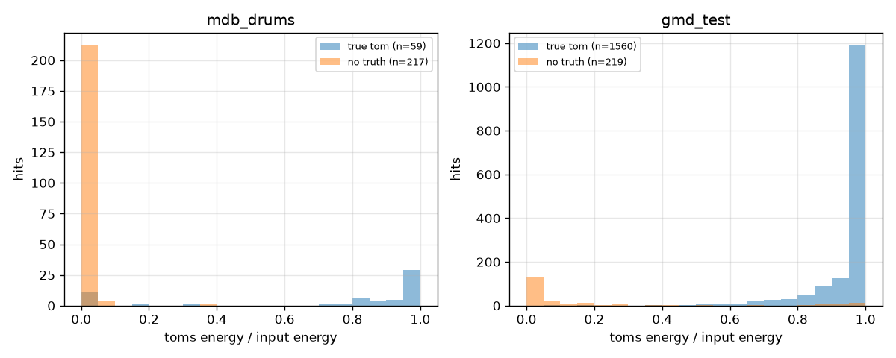

# 곡별 탐 음높이 방식·탐 거르기 실험 (S15P31A307-164)

측정일 2026-10-27 · 모델 ADTOF + 드럼 킷 분리(`adtof_drumsep`) · 입력 정답 드럼 트랙 · 규칙만 다시 돌리는 도구(`rule-eval`)로 후보 27개 비교, 고른 후보는 실제 벤치마크로 재확인

## 결론

- **탐 거르기 채택 제안.** ADTOF가 탐이라고 한 타격 중 드럼 킷 분리의 toms 트랙 에너지가 입력 드럼 에너지의 10%보다 작은 것은 탐이 아님(`tom_gate_ratio: 0.10`). 탐 F1이 GMD 0.880 → 0.919, MDB 0.213 → 0.432로 둘 다 오르고 다른 패드는 변화 없음. 정답 없는 탐이 MDB 217개 → 1개, GMD 219개 → 69개로 줄고, 잃는 진짜 탐은 GMD 3개·MDB 11개(Grunge 한 곡, 아래)
- **거른 탐을 스네어로 돌리기는 작은 추가 이득.** 거른 탐 대부분이 정답 스네어 옆이라 ADTOF 스네어 타격이 50ms 안에 없으면 SNARE로 돌리면(`tom_gate_action: snare`) MDB 스네어 F1 0.805 → 0.822(맞힘 +104, 헛것 +45), GMD는 0.660 → 0.661. 탐 점수는 그대로
- **곡별 상대 방식(음높이 순서로 탐 3종 나누기)은 채택 안 함.** GMD 탐 F1이 0.880 → 0.374로 무너지고(가장 좋은 변형도 0.705), MDB는 거르기를 같이 켜면 고정 경계와 똑같음(0.432). 이유는 아래
- 기본값은 이 작업에서 바꾸지 않음. 후속 작업 "[CHART-003 | AI] 탐 거르기 규칙 기본값 반영"에서 yaml 기본값 교체와 결과표 갱신

## 거르기 비율: 진짜 탐과 가짜 탐이 갈리는가

ADTOF가 탐으로 잡은 타격마다 타격 직후 120ms 구간의 toms 트랙 에너지 / 입력 드럼 에너지를 잼. 정답 탐과 50ms 안에 짝지어지면 "정답 탐", 아니면 "정답 없음".

| 묶음 | 종류 | 타격 수 | 10% | 25% | 중앙값 | 75% | 90% |
| --- | --- | --- | --- | --- | --- | --- | --- |
| MDB 23곡 | 정답 탐 | 59 | 0.001 | 0.777 | 0.929 | 0.992 | 0.995 |
| MDB 23곡 | 정답 없음 | 217 | 0.000 | 0.000 | 0.000 | 0.000 | 0.003 |
| GMD 45개 | 정답 탐 | 1560 | 0.850 | 0.958 | 0.997 | 1.006 | 1.012 |
| GMD 45개 | 정답 없음 | 219 | 0.000 | 0.000 | 0.015 | 0.160 | 0.860 |



- 진짜 탐은 toms 트랙이 입력 에너지의 대부분을 가져가고(중앙값 0.93~1.0), 가짜 탐은 거의 0. 문턱값 0.05~0.2 어디를 잡아도 비슷함
- 문턱값보다 낮은 진짜 탐: MDB 11개는 전부 MusicDelta_Grunge의 플로어탐(음높이 78Hz). 드럼 킷 분리가 이 낮은 탐을 toms 트랙에 거의 넣지 않음. GMD는 1~3개
- 정답 없는 탐이 실제로 무슨 소리였는지(50ms 안 가장 가까운 정답): GMD 스네어 149·하이햇 42·킥 18·라이드 9, MDB 스네어 138·하이햇 41·킥 36·라이드 2. 즉 ADTOF가 스네어를 탐으로 잡는 일이 가장 많음
- 거를 탐 중 정답 스네어 옆인데 ADTOF 스네어 타격이 따로 없는 것: MDB 102개, GMD 15개. 이것이 스네어로 돌렸을 때 얻는 양

## 후보 비교

점수는 패드별 온셋 F1(50ms, 개수 합산). 배정 정확도는 정답과 시각이 맞은 탐 중 3종을 맞게 붙인 비율. 고정 경계는 113·142Hz, 탐 음높이 구간 120ms, 심벌 80ms(지금 기본값). 전체 27개는 `candidates_scores.csv`.

| 후보 | GMD 탐 F1 | GMD 배정 정확도 | GMD 정답 없는 탐 | MDB 탐 F1 | MDB 배정 정확도 | MDB 정답 없는 탐 | 스네어 F1 GMD / MDB |
| --- | --- | --- | --- | --- | --- | --- | --- |
| 지금 기본값 (고정 경계) | 0.880 | 0.979 | 219 | 0.213 | 0.661 | 217 | 0.660 / 0.805 |
| 고정 + 거르기 0.05 | 0.914 | 0.979 | 91 | 0.420 | 0.625 | 5 | 0.660 / 0.805 |
| **고정 + 거르기 0.10** | **0.919** | 0.979 | 69 | **0.432** | 0.625 | 1 | 0.660 / 0.805 |
| 고정 + 거르기 0.20 | 0.925 | 0.979 | 45 | 0.420 | 0.617 | 1 | 0.660 / 0.805 |
| 고정 + 거르기 0.50 | 0.927 | 0.980 | 32 | 0.412 | 0.609 | 0 | 0.660 / 0.805 |
| 고정 + 거르기 0.10, 재는 구간 40ms | 0.925 | 0.980 | 52 | 0.429 | 0.625 | 2 | 0.660 / 0.805 |
| **고정 + 거르기 0.10 + 스네어로 돌림** | 0.919 | 0.979 | 69 | 0.432 | 0.625 | 1 | **0.661 / 0.822** |
| 곡별 상대, 이름은 고정 경계로 | 0.374 | 0.414 | 219 | 0.235 | 0.729 | 217 | 0.660 / 0.805 |
| 곡별 상대, 이름은 순서로 | 0.269 | 0.299 | 219 | 0.268 | 0.831 | 217 | 0.660 / 0.805 |
| 곡별 상대, 틈 1반음 | 0.590 | 0.656 | 219 | 0.235 | 0.729 | 217 | 0.660 / 0.805 |
| 곡별 상대 + 거르기 0.10 | 0.420 | 0.446 | 69 | 0.432 | 0.625 | 1 | 0.660 / 0.805 |
| 곡별 상대, 틈 1반음 + 거르기 0.10 | 0.705 | 0.751 | 69 | 0.432 | 0.625 | 1 | 0.660 / 0.805 |
| 곡별 상대, 묶음 2개 + 거르기 0.10 | 0.414 | 0.440 | 69 | 0.432 | 0.625 | 1 | 0.660 / 0.805 |

- 거르기 문턱값은 0.10을 고름. GMD는 높일수록 조금 오르지만(0.919 → 0.927) 진짜 탐을 더 잃고(1557 → 1547), MDB는 0.10이 최고. 0.05~0.5 사이 차이는 GMD 0.013, MDB 0.02라 어느 값이든 결과가 크게 다르지 않음
- 거르기는 탐 타격을 빼기만 하므로 킥·하이햇·크래시·라이드 점수는 모든 후보에서 같음. 스네어는 "스네어로 돌림" 후보에서만 바뀜
- 정답과 짝지어진 탐 수: GMD 1560 → 1557(거르기 0.10), MDB 59 → 48. MDB의 11개는 전부 Grunge 플로어탐

## 곡별 상대 방식이 안 되는 이유

곡 안의 탐 타격 음높이를 모아 큰 틈(기본 2반음)에서 최대 3묶음으로 나누고 낮은 순서로 플로어·미드·스몰 이름을 붙임. 묶음이 3개보다 적으면 묶음 중앙값을 고정 경계로 이름 짓거나(bands) 순서만으로(order) 붙임.

- 정답 없는 탐(스네어·하이햇 소리)은 음높이가 높아 "스몰탐" 묶음을 차지하고, 진짜 탐 세 개가 한 칸씩 낮은 이름으로 밀림. GMD에서 탐 배정 정확도가 0.979 → 0.414로 떨어진 주된 원인. 거르기로 가짜 탐을 69개까지 줄여도 같은 일이 남아 0.446
- 곡에 탐이 1~2종만 나오면 순서로는 어느 탐인지 알 수 없음. 중앙값을 고정 경계로 이름 지으면 결국 고정 경계 방식과 같아짐. GMD 45개 중 탐이 있는 18개의 묶음 수는 1개 5곡·2개 8곡·3개 5곡
- MDB 정답은 같은 곡에서 플로어탐과 미드탐 음높이가 거의 같은 경우가 있음(MusicDelta_FreeJazz 플로어 164Hz·미드 168Hz, FusionJazz 162·183Hz). 음높이로는 어떤 규칙도 못 가름. MDB에서 상대 방식이 고정 경계보다 나아 보이는 배정 정확도(0.729~0.881)는 가짜 탐 217개를 같이 세지 않은 값이고, 거르기를 켜면 고정 경계와 똑같은 0.625가 됨

## 거르기 뒤에도 남는 MDB 탐 문제

MDB 정답 탐 90개 기준, 거르기 0.10을 켠 뒤

| 항목 | 수 | 원인 |
| --- | --- | --- |
| ADTOF가 못 잡음 | 31 | 모델 |
| 거르기로 잃음 | 11 | 드럼 킷 분리가 Grunge 78Hz 플로어탐을 toms 트랙에 안 넣음 |
| 짝은 맞았는데 패드가 틀림 | 18 | FreeJazz 12개 전부(플로어 164Hz를 스몰탐으로), FusionJazz 4, Punk 2 |
| 맞게 붙임 | 30 | |

MDB 탐 F1 0.432는 아직 쓸 만한 수준이 아님. 남은 세 가지는 규칙(경계·구간·거르기)으로 못 고치는 부분임.

## 바꾼 것

규칙 기본값은 그대로. `adtof_drumsep_transcriber.py`에 선택 키 추가(`tom_mode`·`tom_relative_*`·`tom_gate_ratio`·`tom_gate_window_ms`·`tom_gate_action`), 새 키를 안 넣으면 결과가 전과 같음. `rule-eval`은 곡마다 버린 탐 수·묶음 수를, `tom-pitch`는 거르기 비율 분포와 문턱값별 버려지는 수를 냄.

## 재현

```bash
uv run ssaplash-bench tom-pitch --dataset configs/bench/datasets/mdb_drums.yaml configs/bench/datasets/gmd_test.yaml --out data/results/tom-pitch-w120 --window-ms 120
uv run ssaplash-bench rule-eval --dataset configs/bench/datasets/gmd_test.yaml configs/bench/datasets/mdb_drums.yaml --candidates docs/chart-rules/tom-relative-gate-2026-10-27/candidates.yaml --out data/results/rule-eval-tom-gate
# 고른 후보를 실제 벤치마크로 재확인 (GPU)
uv run ssaplash-bench run-transcription --models docs/chart-rules/tom-relative-gate-2026-10-27/adtof_drumsep_gate010.yaml --dataset configs/bench/datasets/mdb_drums.yaml --input drums --run-id gate010-mdb
```

거르기 0.10을 실제 벤치마크(`run-transcription`, MDB 23곡)로 다시 돌린 결과가 규칙만 다시 돌린 점수와 23곡 × 8패드의 맞힘·헛것·놓침 개수 전부 같음(차이 0). 서비스 추론 모듈은 같은 규칙 함수를 쓰므로 기본값을 바꾸면 그대로 반영됨.

파일: `candidates.yaml`(후보 27개), `candidates_scores.csv`(후보 × 묶음 점수), `by_song_mdb.csv`(MDB 곡별), `pred_tom.csv`(예측 탐마다 음높이·거르기 비율·짝지은 정답·근처 정답), `tom_gate_ratio.png`, `adtof_drumsep_gate010.yaml`(재확인용 모델 yaml)
