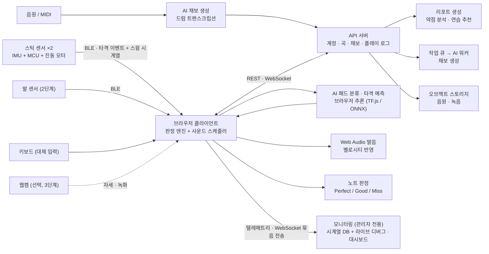

# 에어 드럼 프로젝트 공통 명세서

| 항목 | 내용 |
| --- | --- |
| 문서 상태 | **v0.3 초안** — 10/15 기획발표 논의 기준 + 10/16 모니터링 범위 추가. Notion 페이지의 v0.2(AI 파트 MVP 범위 반영)는 이 파일에 아직 미반영. 팀 검토 후 v1.0으로 확정한다 |
| 작성일 | 2026-10-15 |
| 대상 독자 | 전 파트(FE · BE · AI · EMB · Infra). 기획·설계·구현·발표의 공통 기준 |
| JIRA | `S15P31A307` (관련 Task: S15P31A307-10 주제 확정, -11 핵심 기능 정의, -14 사용자 시나리오) |

## 근거 문서

이 문서는 아래 Notion 자료를 한 곳에 종합한 것이다. 세부 근거가 필요하면 원문을 본다.

| 문서 | 성격 | 링크 |
| --- | --- | --- |
| 10/15 : 기획발표 | 발표 목차·논의 메모 (최신 방향) | [Notion](https://app.notion.com/p/3fa3e3e253dc800ca161f627b28bcb8c) |
| 에어악기기획 (v3) | 기획 초안 본문. 센서 주 입력 · 채보 검증 구조 · AI 설계 | [Notion](https://app.notion.com/p/3f73e3e253dc81b29d0efec0f7fd4aa5) |
| 기획 배경·문제 정의 레퍼런스 | 수치 자료 모음 (신뢰도 표기 포함) | [Notion](https://app.notion.com/p/3fa3e3e253dc81b6b940ffbbc644f5b4) |
| 10/13 컨설턴트 미팅 | 주제 피드백 (완성도·실시간성·스틱 센서 제안) | [Notion](https://app.notion.com/p/3f83e3e253dc8058aa93f59b08523035) |
| 10/14 팀 미팅 | 효용성 검증·키보드 MVP·베타테스트 의견 | [Notion](https://app.notion.com/p/3f93e3e253dc8011bec6ec6fc59f61a0) |
| 핵심 기능 정의 및 우선순위 설정 | Must/Should/Could 기준 정의 | [Notion](https://app.notion.com/p/3f83e3e253dc8077b255f7664bcf7ebc) |
| 사용자 시나리오 및 정보 구조 설계 | 초기 시나리오·IA 초안 | [Notion](https://app.notion.com/p/3f93e3e253dc80b08f03d6dfa80e875d) |

## 표기 규칙

- **[확정]** 팀 합의가 끝난 내용.
- **[제안]** 회의·기획안에서 나왔지만 아직 합의되지 않은 내용. 기본값으로 삼되 바뀔 수 있다.
- **[미결]** 팀 결정이 필요한 항목. 20장에 모아 두었다.
- 수치 중 "실측 후 확정"이 붙은 값은 설계용 가정치다. 실측값이 나오면 이 문서를 갱신한다.

---

## 1. 프로젝트 개요

### 1-1. 한 줄 정의

> IMU 센서가 달린 **스틱 한 쌍으로 허공을 치면**, 센서가 "언제 · 어느 패드를 · 얼마나 세게" 쳤는지 수 ms 안에 잡아내고, **리듬 게임처럼 채보를 따라 연습**하며 **AI가 채보 생성과 코칭**을 맡는 웹 기반 에어 드럼 서비스.

### 1-2. 핵심 가치 (와우 포인트)

10/15 회의에서 발표의 축으로 잡은 네 가지다.

| 축 | 내용 | 상태 |
| --- | --- | --- |
| 연주 | 스틱 **타격감(진동)**, **세기 반영**, 웹과 하드웨어가 연동되는 **세팅 페이지** | [제안] |
| 채보 (AI) | 듣고 싶은 음악을 올리면 AI가 드럼 채보를 만들어 준다 | [제안] |
| 코칭 (AI) | 실시간 피드백 + 플레이 후 점수·약점 리포트 | [제안] |
| 게임 이펙트 | 판정·콤보 연출. UX의 결정적 요소 | [제안] |

### 1-3. 범위 요약

| 포함 | 제외 (현 단계) |
| --- | --- |
| 드럼 1종 (악기 확장은 추후 방향성으로만 언급) | 기타·피아노 등 다른 악기 |
| 스틱 센서 2개 + 브라우저 클라이언트 + 서버 | 네이티브 앱 |
| 리듬 게임 · 자유 · 박자 모드 | 멀티플레이·랭킹 (3단계 확장) |
| MIDI → 채보(1단계), 음원 → 채보(2단계) | 유료 음원 스트리밍 연동 |
| 킥·하이햇 페달: 1단계 키보드/페달 대체, 2단계 발 센서 | — |

### 1-4. 서비스명

[미결] 회의록에서 "퍼니드럼"이라는 가칭이 한 번 쓰였다. 정식 명칭은 미정.

---

## 2. 문제 정의와 배경

### 2-1. 배경

- 드럼은 배우고 싶은 사람은 많지만 **가격 · 공간 · 소음** 때문에 시작 장벽이 가장 높은 악기다. 공동주택에서는 연습 자체가 어렵다.
- 전자드럼도 입문형이 70~100만 원대이고 자리를 차지하며, 킥 페달 진동은 층간소음 원인이 된다.
- 소형 IMU 모듈과 BLE 마이크로컨트롤러는 몇천 원대로 내려왔고, 브라우저가 Web Bluetooth로 직접 받을 수 있다.

### 2-2. 연습 환경별 문제 (발표 비교표 초안)

10/15 회의에서 "합주실 / 레슨 / 집"을 한 번에 다룰지, 각각 다룰지, 비교표로 할지 **[미결]**이다. 비교표 형식으로 먼저 정리해 둔다.

| 구분 | 비용 | 접근성 | 소음·공간 | 피드백 |
| --- | --- | --- | --- | --- |
| 학원 레슨 | 월 15~20만 원 | 주 1회 50분, 이동 필요 | 해결됨 | 강사 피드백 있음 (수업 중에만) |
| 연습실 대관 | 시간당 5천~1만 원 | 예약·이동 필요 | 해결됨 | 없음 |
| 집 (전자드럼) | 초기 70~100만 원 | 상시 | 공간 차지, 킥 진동 | 없음 |
| 집 (기존 에어 드럼 앱·제품) | 저가~중가 | 상시 | 해결됨 | 소리만 남. 인식 지연·오인식 불만 |
| **이 프로젝트** | 센서 스틱 + 브라우저 | 상시, 설치 없음 | 무타격·무진동 | 채보 판정 + AI 리포트 |

출처·신뢰도는 수치 레퍼런스 문서를 따른다. 핵심 인용 수치는 아래와 같다.

| 메시지 | 수치 | 출처 (신뢰도) |
| --- | --- | --- |
| 배우고 싶은 분야 1위는 음악 | 문화예술교육 희망 분야 음악 57.6% | 문체부 2022 (◎) |
| 그런데 실제 참여는 적다 | 성인 서양음악 교육 경험 2.7%, 20대 5.6% | 문체부 2023 원자료 재분석 (△) |
| 왜 못 하나 | 시간 없음 64.0%, 가까운 시설 없음 20.3% | 문체부 2022 (◎) |
| 적정 비용과 실제 비용의 격차 | 지불 의향 월 7.3만 원 vs 드럼 학원 월 15~20만 원 | 문체부 2022 (◎) + 시장가 조사 |
| 혼자 시작하면 포기한다 | 기타 입문자 90%가 1년 내 포기 | Fender CEO 2022 (○) |
| 집에서 못 치는 구조 | 층간소음 민원 2023년 111,959건 | 국회 자료 보도 (○) |
| 에어 드럼 카테고리의 지불 의향 | PocketDrum 펀딩 $487,877 / 3,927명 | Indiegogo (○) |

### 2-3. 기존 해법의 한계

| 방식 | 한계 |
| --- | --- |
| 카메라 기반 에어 드럼 앱 | 30fps(프레임당 33ms) + 처리 지연으로 소리가 늦거나 타격을 놓친다. 조명·화각에 약하다 |
| 센서 기반 제품 (Freedrum, PocketDrum) | 타이밍은 빠르나 패드 구분을 방향 각도 규칙에 의존해 인접 패드 혼동·드리프트가 생긴다. "소리 내기"에 그치고 실력이 느는 연습 도구가 아니다. 타격감이 없다는 불만이 가장 크다 |
| 전자드럼 | 비싸고 공간을 차지하며 킥 진동이 남는다 |

### 2-4. 접근 전환: 열린 인식 → 채보 검증

기존 제품이 틀리는 근본 원인은 사용자의 자유로운 움직임 전체를 열린 문제로 인식하려 하기 때문이다. **채보(정답 시간표)가 있으면 문제가 바뀐다.**

- **언제**: IMU 타격 피크의 타임스탬프로 사후 판정한다. 통신·처리 지연과 무관하다.
- **무엇을**: "채보가 요구한 패드 쪽으로 스윙했는가"라는 소수 후보 확인 문제가 된다.
- **소리**: 채보에 따라 미리 스케줄하고 놓치면 음소거한다. 소리가 늦게 날 수 없다.
- **데이터**: 채보가 곧 학습 데이터의 정답 라벨이 되어 플레이할수록 데이터가 쌓인다.

### 2-5. 핵심 질문

> 채보 기반 에어 드럼에서, IMU 시계열만으로 어느 패드를 언제 얼마나 세게 쳤는지 **방향 각도 규칙 대비 AI 분류·예측이 얼마나 더 정확한지** 수치로 입증할 수 있는가?

---

## 3. 타깃 사용자

10/15 회의에서 "처음 / 취미 / 프로" 세 층을 실사용 후기·효용성 검증 대상으로 잡았다. 1차 타깃은 **[미결]** (입문자 연습용 vs 엔터테인먼트 vs 둘 다).

| 구분 | 설명 | 핵심 요구 | 검증 방법 (제안) |
| --- | --- | --- | --- |
| 처음 (입문자) | 드럼을 배우고 싶지만 시작 못 한 사람 | 쉬운 진입, 재미, 틀려도 괜찮은 피드백 | 아무나 (팀 설문 응답자) |
| 취미 (아마추어) | 밴드부·사회인 밴드. 연습 시간·장소가 부족 | 곡 연습, 약점 파악, 집에서 반복 | 사회인 밴드 섭외 (회의록: 윤영) |
| 프로 (연주자) | 세션·강사 | 녹음 내보내기, 정밀한 세기·타이밍 데이터 | 밴드 세션 섭외 |

10/14 회의 의견: 설문 대상을 SSAFY 내부에 한정하지 말고 **실제 음악인**으로 넓히고, **교육적 효용성**이 보이도록 **베타테스트 단계**를 두자. 팀 설문(forms.gle/ge9N2ydLRPNPrcV57)이 1차 자료다. 결과는 [미결] (아직 이 문서에 반영되지 않음).

---

## 4. 차별점

| 비교 | 카메라 전용 앱 | 센서 전용 제품 | 기존 리듬 게임 | 이 프로젝트 |
| --- | --- | --- | --- | --- |
| 타이밍 | 프레임 속도에 묶임 | 빠름 | 컨트롤러라 정확 | **센서 수 ms + 채보 사후 판정** |
| 패드 구분 | 손 위치, 느림 | 방향 각도 규칙, 혼동·드리프트 | 버튼 | **AI 시계열 분류 + 채보 후보 제한 + 드리프트 보정** |
| 세기 | 거의 불가 | 가능 | 없음 | **가능 + 사용자별 보정** |
| 타격감 | 없음 | 없음 | 컨트롤러 진동 | **스틱 진동 피드백** [제안] |
| 콘텐츠 | 없음 | 없음 | 제작자가 만든 채보만 | **AI가 음원·MIDI에서 채보 자동 생성** |
| 연습 도구 | 없음 | 앱에 따라 다름 | 점수만 | **약점 리포트 + 맞춤 연습 패턴** |
| 세팅 | 고정 | 앱에서 각도 설정 | — | **웹에서 가상 키트 배치를 바꾸면 센서 판정이 따라감** [제안] |
| 연주자용 | — | MIDI 출력 일부 | — | **녹음 → MIDI/오디오 내보내기** [제안] |
| 환경 | 조명·웹캠 필요 | 어디서나 | 전용 컨트롤러 | **어디서나, 브라우저만** |

회의록에서 "가격적 메리트" 항목은 **제외**하기로 했다 (취소선 처리됨).

---

## 5. 용어 정의

전 파트가 같은 단어를 같은 뜻으로 쓰기 위한 사전이다. 코드 식별자·API 필드명도 이 영문 표기를 따른다.

| 용어 | 영문 | 정의 |
| --- | --- | --- |
| 패드 | pad | 가상 드럼 키트의 타격 대상 하나. 전체 9종 = 스틱 7(크래시 `CRASH`, 하이햇 `HIHAT`, 스네어 `SNARE`, 스몰탐 `SMALL_TOM`, 미드탐 `MID_TOM`, 플로어탐 `FLOOR_TOM`, 라이드 `RIDE`) + 페달 2(킥 `KICK`, 하이햇 페달 `HIHAT_PEDAL`). 1단계 연동은 스틱 4개(하이햇·스네어·스몰탐·플로어탐)부터 시작해 7개로 확장한다 (미결 #9 결정, 10/23) |
| 키트 | kit | 패드들의 집합과 공간 배치. 세팅 페이지에서 사용자가 바꾼다 |
| 타격 | hit | 센서가 감지한 한 번의 타격 이벤트. 타임스탬프 · 피크 가속도 · 스윙 시계열을 가진다 |
| 스윙 시계열 | swing window | 타격 직전 약 200ms의 6축 IMU 샘플 묶음. 패드 분류 모델의 입력 |
| 세기 / 벨로시티 | velocity | 피크 가속도에서 계산한 타격 강도. MIDI 관례대로 0~127 |
| 채보 | chart | 곡의 드럼 노트 시퀀스. 노트마다 시각(ms) · 패드 · 세기 힌트를 가진다 |
| 노트 | note | 채보의 요소 하나. "이 시각에 이 패드를 쳐라" |
| 판정 | judgement | 노트와 타격을 대조한 결과. Perfect / Good / Miss |
| 판정 폭 | timing window | 노트 시각 기준 Perfect·Good으로 인정하는 ± ms 범위. 실측 후 확정 (가정: Perfect 25ms, Good 60ms) |
| 캘리브레이션 | calibration | 시작 시 패드별 기준 자세와 오디오 출력 오프셋을 맞추는 절차 |
| 드리프트 | drift | 자이로 적분 누적 오차로 기준 자세가 틀어지는 현상 |
| 플레이 로그 | play log | 한 번의 플레이에서 수집한 타격·판정·스윙 시계열 전체. AI 학습 데이터의 원천 |
| 리포트 | report | 플레이 로그를 분석한 결과. 점수, 타이밍 오차 분포, 약점 구간, 연습 추천 |
| 모드 | mode | 리듬 게임 모드(채보 따라치기) / 자유 모드 / 박자 모드(메트로놈) |
| 기준선 | baseline | 방향 각도 규칙 기반 패드 판정. AI 모델의 비교 대상 |

---

## 6. 기능 명세

우선순위 기준은 "핵심 기능 정의 및 우선순위 설정" 문서를 따른다.

| 등급 | 정의 |
| --- | --- |
| Must | 없으면 서비스가 성립하지 않고 발표 시연도 못 한다 |
| Should | 없어도 기본 시연은 가능하지만 완성도가 떨어진다 |
| Could | 시간이 남으면 추가한다 |

단계(0~3)는 14장 단계별 범위를 따른다. 기능 ID는 JIRA Story 제목과 설계 문서에서 그대로 참조한다.

### 6-1. 연주 입력 · 출력 (PLAY)

| ID | 기능 | 설명 | 우선순위 | 단계 | 파트 |
| --- | --- | --- | --- | --- | --- |
| PLAY-01 | 센서 연결 | Web Bluetooth로 스틱 센서 2개를 브라우저에 연결하고 상태를 표시한다 | Must | 1 | FE · EMB |
| PLAY-02 | 타격 감지 | MCU가 가속도 피크로 타격을 감지하고 타임스탬프 · 피크값 · 스윙 시계열을 전송한다 | Must | 1 | EMB |
| PLAY-03 | 패드 판정 (기준선) | 자이로 적분 자세의 피치·요를 패드 영역에 매핑해 어느 패드인지 판정한다 | Must | 1 | EMB · AI |
| PLAY-04 | 패드 판정 (AI) | 스윙 시계열 → 패드 분류 모델. 채보 후보로 출력을 제한한다. 브라우저 추론 | Should | 2 | AI · FE |
| PLAY-05 | 세기 반영 | 피크 가속도를 벨로시티로 바꿔 소리 크기·샘플 레이어에 반영한다 | Must | 1 | EMB · FE |
| PLAY-06 | 저지연 사운드 | Web Audio로 드럼 샘플을 재생한다. 리듬 게임 모드는 채보에 따라 사전 스케줄, 자유 모드는 즉시 발음 | Must | 1 | FE |
| PLAY-07 | 스틱 진동 피드백 | 타격 감지 즉시 스틱의 진동 모터를 울려 타격감을 준다. 세기에 따라 강도 조절 | Should | 1~2 | EMB |
| PLAY-08 | 캘리브레이션 | 시작 시 패드별 2타로 기준 자세를 잡고, 오디오 출력 오프셋을 측정한다 | Must | 1 | FE · EMB |
| PLAY-09 | 드리프트 보정 | 곡 시작 시 리셋, 곡 중 Perfect 노트로 기준 자세를 계속 보정한다 | Should | 1 | FE · AI |
| PLAY-10 | 키보드 입력 대체 | 스틱 없이 키보드로 패드를 치는 입력 경로. MVP 시연 안전망이자 FE 개발용 | Must | 0 | FE |
| PLAY-11 | 폰 IMU 입력 (0단계) | 스마트폰 DeviceMotion으로 타격·패드 데이터를 수집하는 프로토타입 경로 | Should | 0 | FE · AI |
| PLAY-12 | 킥·하이햇 페달 | 1단계: 키보드/USB 페달 또는 채보에서 제외. 2단계: 발목 센서 | Could | 2 | EMB |

PLAY-07 비고: 진동은 브라우저를 거치지 않고 **MCU에서 타격 감지 직후 로컬로** 트리거해야 지연이 없다. 진동이 IMU에 잡히는 자기 간섭(오탐)을 실측해야 한다. 10/15 회의에서 "에어로드럼의 가장 큰 불만"으로 꼽힌 항목이라 발표 와우 포인트이나, 하드웨어 범위가 늘어나므로 우선순위는 [미결].

### 6-2. 세팅 (SETUP)

| ID | 기능 | 설명 | 우선순위 | 단계 | 파트 |
| --- | --- | --- | --- | --- | --- |
| SETUP-01 | 가상 키트 배치 | 웹 화면에서 패드를 드래그해 위치·각도를 바꾼다. 바뀐 배치가 센서의 패드 판정 영역에 즉시 반영된다 ("웹에서 멀리 떨어뜨리면 센서도 멀게") | Should | 1 | FE · EMB |
| SETUP-02 | 패드별 사운드 선택 | 패드마다 드럼 샘플(킷 종류)을 고른다. "감으로"가 아니라 구체적인 세팅값으로 | Should | 1 | FE |
| SETUP-03 | 민감도 · 판정 폭 조절 | 타격 임계값, 세기 곡선, 판정 폭을 사용자가 조절한다 | Could | 2 | FE · EMB |
| SETUP-04 | 키트 프리셋 저장 | 배치·사운드 세팅을 계정에 저장하고 불러온다 | Should | 1 | FE · BE |

### 6-3. 모드 (MODE)

| ID | 기능 | 설명 | 우선순위 | 단계 | 파트 |
| --- | --- | --- | --- | --- | --- |
| MODE-01 | 리듬 게임 모드 | 채보를 따라 친다. 노트 레인 · 판정 연출 · 콤보 · 점수 | Must | 1 | FE |
| MODE-02 | 자유 모드 | 채보 없이 친다. 전체 패드 분류 사용. 즉흥 연주·녹음용 | Must | 1 | FE |
| MODE-03 | 박자 모드 | 메트로놈이 울리고 박자에 맞춰 치면 타이밍 정확도를 보여 준다. 입문자 기초 연습 | Should | 1 | FE |
| MODE-04 | 게임 이펙트 | 판정별 시각·청각 연출, 콤보 효과. UX 결정 요소 | Should | 1 | FE |
| MODE-05 | 난이도 선택 | 채보의 노트 밀도별 버전(쉬움/보통/어려움) 선택 | Should | 1 | FE · AI |
| MODE-06 | 난이도 자동 조절 | 실시간 성과로 노트 밀도·판정 폭을 조절 | Could | 3 | AI · FE |

### 6-4. 채보 (CHART)

| ID | 기능 | 설명 | 우선순위 | 단계 | 파트 |
| --- | --- | --- | --- | --- | --- |
| CHART-01 | 기본 곡 라이브러리 | 자작·퍼블릭 도메인 곡과 채보를 제공한다 | Must | 1 | BE · AI |
| CHART-02 | MIDI → 채보 변환 | MIDI 파일을 올리면 GM 드럼 노트 매핑으로 채보를 만들고 난이도별로 노트를 솎는다 (규칙 기반) | Must | 1 | AI · BE |
| CHART-03 | 음원 → 채보 생성 | 음원을 올리면 드럼 트랜스크립션 모델로 채보를 만든다. 비동기 작업 큐 | Should | 2 | AI · BE · Infra |
| CHART-04 | 채보 생성 진행 표시 | 업로드 → 처리 중 → 완료를 WebSocket으로 알린다 | Should | 2 | FE · BE |
| CHART-05 | 채보 편집 | 생성된 채보의 노트를 사용자가 수정한다 | Could | 3 | FE · BE |

### 6-5. 코칭 · 리포트 (COACH)

| ID | 기능 | 설명 | 우선순위 | 단계 | 파트 |
| --- | --- | --- | --- | --- | --- |
| COACH-01 | 실시간 피드백 | 플레이 중 판정 결과와 타이밍 빠름/늦음을 즉시 표시한다 | Must | 1 | FE |
| COACH-02 | 플레이 결과 리포트 | 점수, 판정 분포, 노트별 타이밍 오차·세기 편차 그래프 | Must | 1 | FE · BE |
| COACH-03 | 약점 구간 분석 | "하이햇→스네어 전환에서 늘 늦음", "왼손이 약함" 같은 패턴을 규칙 기반으로 찾는다 | Should | 1~2 | AI · BE |
| COACH-04 | 맞춤 연습 패턴 추천 | 약점에 맞는 짧은 연습 채보를 생성·추천한다 | Should | 2 | AI |
| COACH-05 | LLM 코칭 문장 | 리포트를 자연어 설명·조언으로 바꾼다. UX 보조 용도에 한정 | Could | 3 | AI · BE |
| COACH-06 | 성장 추이 | 곡별·기간별 점수와 정확도 변화 | Should | 2 | FE · BE |
| COACH-07 | 자세 피드백 (웹캠) | 팔 궤적·어깨 높이를 리포트에 추가. 판정에는 쓰지 않는다 | Could | 3 | AI · FE |

### 6-6. 녹음 · 내보내기 (REC)

| ID | 기능 | 설명 | 우선순위 | 단계 | 파트 |
| --- | --- | --- | --- | --- | --- |
| REC-01 | 연주 녹음 | 자유·리듬 게임 모드의 타격 시퀀스를 저장한다 | Should | 1 | FE · BE |
| REC-02 | MIDI 내보내기 | 녹음을 표준 MIDI 파일로 내보낸다. 연주자가 DAW에서 쓸 수 있게 | Should | 1~2 | FE |
| REC-03 | 오디오 내보내기 | 녹음을 WAV/MP3로 렌더링해 내보낸다 | Could | 2 | FE · BE |
| REC-04 | 영상 녹화·공유 | 웹캠 + 오디오를 MediaRecorder로 녹화하고 공유한다 | Could | 3 | FE · BE |

### 6-7. 계정 · 데이터 (ACCT)

| ID | 기능 | 설명 | 우선순위 | 단계 | 파트 |
| --- | --- | --- | --- | --- | --- |
| ACCT-01 | 회원가입·로그인 | 소셜 로그인 전용(Google · SSAFY Auth), 자체 회원가입 없음 [확정]. 게스트 모드 없이 모든 기능은 로그인 후 사용 | Must | 1 | BE · FE |
| ACCT-02 | 플레이 로그 수집 | 플레이 종료 후 로그를 일괄 업로드한다. 학습 데이터 사용 동의 포함 | Must | 1 | BE · FE |
| ACCT-03 | 학습 데이터 파이프라인 | 플레이 로그 → 라벨링(채보 기준) → 학습 데이터셋 | Should | 1~2 | AI · BE |
| ACCT-04 | 랭킹·공유 | 곡별 점수 랭킹, 결과 공유 | Could | 3 | BE · FE |

ACCT-01 비고 (10/19 결정, 미결 #17):

- 제공자는 Google과 SSAFY Auth 두 가지. Google을 먼저 붙이고 SSAFY Auth는 provider 추가로 확장한다. 회원은 `provider + provider_id` 로 유일하게 식별한다.
- OAuth 2.0 Authorization Code 방식. 콜백은 BE가 받는다.
- 토큰은 access 토큰을 브라우저 메모리에, refresh 토큰을 HttpOnly 쿠키에 둔다. 이를 위해 FE와 API는 같은 도메인에서 서빙한다(Infra).
- 게스트 모드는 두지 않는다. 자유 연주를 포함한 모든 기능은 로그인 후 사용한다.
- 사용자 정보는 닉네임(필수)과 프로필 이미지(선택, 제공자 이미지를 기본값으로)만 둔다.
- ADMIN 역할은 BE 환경 변수의 이메일 화이트리스트로 부여한다(MONITOR-05). 관리자 화면은 네비게이션에 없는 별도 주소에 둔다.
- OAuth 콘솔 앱 등록과 리다이렉트 URI 관리는 PM이 맡는다.

### 6-8. 개발 모니터링 (MONITOR)

사용자 기능이 아니라 **팀이 임베디드 연동을 검증하고 수치를 남기기 위한 내부 도구**다. 센서 → 브라우저 → 판정 → 소리로 이어지는 경로를 눈으로 확인하고, 15장 기술 검증 포인트의 실측값을 여기서 만든다. 여러 파트(EMB · FE · BE · Infra)에 걸치는 인터페이스가 있어 공통 명세에 둔다. 대시보드 구성·DB 선택 같은 상세 설계는 별도 설계 문서와 Infra README에 둔다.

| ID | 기능 | 설명 | 우선순위 | 단계 | 파트 |
| --- | --- | --- | --- | --- | --- |
| MONITOR-01 | 텔레메트리 수집 | 브라우저가 타격 이벤트마다 구간별 시각(센서 타격 · 브라우저 수신 · 판정 완료 · 오디오 스케줄)과 판정 결과를 세션 ID와 함께 서버로 묶음 전송한다. 게임 판정·발음 경로와 분리되어 게임 지연에 영향을 주지 않는다 | Must | 0 | FE · BE |
| MONITOR-02 | 라이브 디버그 페이지 | 지금 진행 중인 플레이 세션을 세션 ID로 구독해 게임 화면과 나란히 본다. 패드별 타격, 구간별 지연, 패킷 유실, 시계 오프셋을 타격 단위로 표시 | Must | 0 | FE |
| MONITOR-03 | 누적 대시보드 | 세션 누적 데이터를 시계열 DB에 저장하고 대시보드(Grafana 등 [미결])로 본다. 펌웨어 버전·센서 위치별 지연 분포, 패드 혼동 행렬, 드리프트 추이, "규칙 vs AI" 비교 | Should | 1 | Infra · BE |
| MONITOR-04 | 원시 데이터 수집 모드 | 수집 모드에서만 IMU 원시 시계열(수백 Hz~1kHz × 6축 × 2개)을 전송·저장한다. 평소에는 타격 이벤트와 스윙 시계열만 저장 | Should | 1 | EMB · FE · BE |
| MONITOR-05 | 관리자 접근 제어 | 모니터링 페이지는 네비게이션에 없는 별도 주소에 두고, 서버에서 ADMIN 역할을 검사해 데이터 스트림·API를 막는다. 주소 숨김은 보조 수단 | Must | 0 | BE · FE |

비고: 손이 닿는 순간 → 스피커 소리의 진짜 끝단 지연은 이 경로로 못 잰다. 슬로모션 촬영·마이크 녹음(12-2 지연 측정 도구)으로 따로 재고 결과를 대시보드에 수기로 기록한다.

---

## 7. 사용자 시나리오

### 7-1. 핵심 시나리오: 곡 연습 (리듬 게임 모드)

1. 사용자가 브라우저에서 서비스에 접속해 로그인한다.
2. 스틱 센서 전원을 켜고 **연결** 버튼으로 두 스틱을 페어링한다. 연결 상태가 화면에 보인다.
3. **캘리브레이션**: 화면 안내에 따라 패드별로 2타씩 친다. 오디오 오프셋을 자동 측정한다.
4. 곡을 고른다. 기본 곡 또는 직접 올린 MIDI·음원에서 생성한 채보.
5. 난이도를 고르고 플레이를 시작한다. 노트가 흘러오고, 채보에 맞춰 허공을 친다.
6. 타격마다 소리가 나고(세기 반영), 스틱이 진동하며, Perfect/Good/Miss 판정과 콤보가 표시된다.
7. 곡이 끝나면 **리포트**가 뜬다. 점수, 타이밍 오차 분포, 약점 구간, 추천 연습 패턴.
8. 추천 연습 패턴을 바로 플레이하거나, 녹음을 MIDI로 내보낸다.

### 7-2. 보조 시나리오

| 시나리오 | 흐름 |
| --- | --- |
| 자유 연주 | 연결 → 캘리브레이션 → 자유 모드 → 즉시 발음 → (녹음) → 내보내기 |
| 박자 연습 | 연결 → 박자 모드 → BPM 선택 → 메트로놈에 맞춰 치기 → 타이밍 정확도 표시 |
| 키트 세팅 | 세팅 페이지 → 패드 드래그로 배치 변경 → 센서 판정 영역 즉시 반영 → 패드별 사운드 선택 → 프리셋 저장 |
| 채보 만들기 | 곡 업로드(MIDI/음원) → 생성 진행 표시 → 난이도별 채보 완성 → 미리듣기 → 플레이 |
| 스틱 없이 체험 | 키보드 입력 모드 선택 → 리듬 게임 플레이 (시연 안전망) |

### 7-3. 화면 구조 (IA) 초안

```
홈
├─ 플레이
│   ├─ 리듬 게임 (곡 선택 → 난이도 → 플레이 → 결과 리포트)
│   ├─ 자유 모드
│   └─ 박자 모드
├─ 곡 라이브러리 (기본 곡 · 내 채보 · 업로드/생성)
├─ 리포트 (최근 플레이 · 성장 추이 · 약점 · 추천 연습)
├─ 녹음 보관함 (재생 · MIDI/오디오 내보내기 · 공유)
├─ 세팅
│   ├─ 키트 배치 · 사운드 (가상 키트 편집기)
│   ├─ 기기 연결 · 캘리브레이션
│   └─ 민감도 · 판정 폭
├─ 계정
└─ (관리자 전용 · 숨김 주소) 모니터링
    ├─ 라이브 디버그 (세션 ID로 진행 중 플레이 구독)
    └─ 누적 대시보드
```

와이어프레임은 별도 UX 작업에서 만든다. 이 IA가 메뉴 이름의 기준이다.

---

## 8. 시스템 구조

### 8-1. 전체 구조



### 8-2. 구성 요소별 책임

| 구성 요소 | 책임 | 파트 |
| --- | --- | --- |
| 스틱 센서 펌웨어 | 고속 IMU 샘플링(수백 Hz~1kHz), 타격 피크 검출, 진동 트리거, 이벤트/원시 스트리밍 모드 전환, BLE 송신, 타임스탬프 | EMB |
| 브라우저 클라이언트 | 센서 수신, 시계 동기화, 패드 판정(기준선/AI), 노트 판정, 사운드 스케줄링, 게임 화면, 세팅, 리포트 화면, 로그 수집·업로드 | FE (+AI 모델 통합) |
| API 서버 | 인증, 곡·채보·프리셋·플레이 로그·리포트 CRUD, 채보 생성 작업 큐 투입, 리포트 생성 배치 | BE |
| AI 워커 | 음원 → 채보 생성, (서버 측) 리포트 약점 분석·연습 패턴 생성 | AI · Infra |
| 학습 파이프라인 | 플레이 로그 → 데이터셋 → 패드 분류/타격 예측 모델 학습 → 브라우저용 변환 | AI |
| 모니터링 | 텔레메트리 수신·시계열 저장, 관리자 라이브 디버그 페이지, 누적 대시보드, ADMIN 접근 제어 | FE · BE · Infra |
| 인프라 | 서버·워커 배포, 스토리지, GPU 서버(학습), 시계열 DB·대시보드 운영 | Infra |

### 8-3. 통신

| 구간 | 방식 | 비고 |
| --- | --- | --- |
| 센서 → 브라우저 (기본) | Web Bluetooth (BLE GATT Notify) | Chrome/Edge 계열만 지원. 연결 간격 7.5~15ms 목표. 센서 2개 동시 연결 실측 필요 |
| 센서 → 브라우저 (대안) | ESP-NOW → USB 동글 → Web Serial | BLE 동시 연결·지연이 불안정할 때. 1단계 중 병행 검증 |
| 전송 내용 | 타격 이벤트(타임스탬프, 피크, 추정 자세) + 스윙 시계열(~200ms × 6축) | 학습 데이터 수집 모드에서는 원시 스트리밍 |
| 시계 동기화 | 센서 타임스탬프 + 연결 시·주기적 오프셋 보정 | 오차가 판정 폭보다 작아야 한다 |
| 클라이언트 ↔ 서버 | REST (곡·채보·리포트·프리셋), WebSocket (채보 생성 진행) | 플레이 로그는 종료 후 일괄 업로드 |
| 클라이언트 → 모니터링 | WebSocket (텔레메트리 이벤트 묶음 전송, 수십~수백 ms 주기) | 게임 판정·발음과 분리된 경로. 같은 PC의 두 탭은 BroadcastChannel로 서버 없이도 가능 |
| 서버 ↔ AI 워커 | 작업 큐 | GPU 필요 여부는 모델 크기 보고 결정 |

### 8-4. 지원 환경 [제안]

- **브라우저**: Chrome / Edge (데스크톱, 안드로이드). Safari·Firefox는 Web Bluetooth 미지원이라 제외.
- **오디오 출력**: 유선 이어폰·스피커. 블루투스 이어폰은 출력 지연이 커서 판정 오프셋이 커진다.
- **센서**: 스틱 끝 클립형 우선 (손목 밴드·반지형과 1단계 중 비교) [미결].

---

## 9. 데이터 정의 (초안)

파트 간 인터페이스의 출발점이다. 필드명은 5장 용어의 영문 표기를 따른다. 상세 스키마·API 명세는 설계 단계에서 별도 문서로 확정한다.

### 9-1. 타격 이벤트 (센서 → 브라우저)

| 필드 | 타입 | 설명 |
| --- | --- | --- |
| `stickId` | 0 / 1 | 왼손 / 오른손 스틱 |
| `timestamp` | uint32 (ms 또는 µs) | 센서 시계 기준 타격 시각 |
| `peakAccel` | float | 피크 가속도 크기 (g). 벨로시티 계산 원천 |
| `pitch`, `yaw` | float | 타격 시점 추정 자세 (기준선 판정용) |
| `swingWindow` | int16[N][6] | 타격 직전 ~200ms의 가속도 3축 + 각속도 3축 |

### 9-2. 채보 (chart)

| 필드 | 타입 | 설명 |
| --- | --- | --- |
| `songId`, `difficulty` | string, enum | 곡 식별자, 난이도 |
| `bpm`, `offsetMs` | number | 기본 템포, 음원 시작 오프셋 |
| `notes[]` | 배열 | 노트 목록 |
| `notes[].timeMs` | number | 노트 시각 |
| `notes[].pad` | enum | 패드. 5장 용어 표의 9종(`CRASH`, `HIHAT`, `SNARE`, `SMALL_TOM`, `MID_TOM`, `FLOOR_TOM`, `RIDE`, `KICK`, `HIHAT_PEDAL`). 구 이름 `HI_TOM`은 `SMALL_TOM`으로 바뀌었고 FE가 당분간 별칭으로 받는다 |
| `notes[].velocityHint` | 0~127 | 권장 세기 (선택) |
| `source` | enum | `BUILTIN` / `MIDI` / `AUDIO` |

### 9-3. 플레이 로그 (play log)

| 필드 | 설명 |
| --- | --- |
| `playId`, `userId`, `songId`, `difficulty`, `mode` | 식별 정보 |
| `kitPreset` | 플레이 당시 키트 배치·사운드 |
| `calibration` | 패드별 기준 자세, 오디오 오프셋 |
| `hits[]` | 타격 이벤트 전체 (9-1) + 판정 결과 (`judgement`, `matchedNoteIndex`, `deltaMs`, `predictedPad`, `baselinePad`) |
| `summary` | 점수, 판정 분포, 최대 콤보 |
| `consent` | 학습 데이터 사용 동의 여부 |

### 9-4. 리포트 (report)

| 필드 | 설명 |
| --- | --- |
| `score`, `accuracy`, `judgementCounts` | 결과 요약 |
| `timingHistogram` | 타이밍 오차 분포 (빠름/늦음) |
| `padStats[]` | 패드별 정확도·평균 오차·평균 세기 |
| `weakSegments[]` | 약점 구간 (시각 범위, 패턴 설명, 원인 태그) |
| `recommendedDrills[]` | 추천 연습 패턴 (채보 ID) |

### 9-5. 텔레메트리 이벤트 (telemetry event, 모니터링용)

| 필드 | 설명 |
| --- | --- |
| `sessionId`, `userId`, `mode` | 플레이 세션 식별. 모니터링 페이지는 `sessionId`로 구독한다 |
| `tSensor`, `tRecv`, `tJudge`, `tAudio` | 센서 타격 시각(MCU 시계) · 브라우저 수신 · 판정 완료 · 오디오 스케줄 시각. 차이가 구간별 지연 |
| `clockOffsetMs` | 센서 ↔ 브라우저 시계 오프셋 추정값 |
| `stickId`, `pad`, `baselinePad`, `predictedPad`, `judgement`, `deltaMs`, `velocity` | 타격·판정 결과 (9-1, 9-3과 같은 값) |
| `tags` | 범주화용 태그: 펌웨어 버전, 센서 부착 위치, 입력 경로(스틱/키보드/폰 IMU), 테스터 ID |
| `packetLoss`, `batteryPct` | 연결 품질·기기 상태 (주기 전송) |
| `rawWindow` | 원시 IMU 시계열. 수집 모드(MONITOR-04)에서만 포함 |

---

## 10. 비기능 요구사항

| 항목 | 목표 | 상태 |
| --- | --- | --- |
| 타격 → 소리 체감 지연 (자유 모드) | 20ms 이하 목표 (BLE + 처리 + 오디오 출력 합산). 실측 후 확정 | [제안] |
| 타격 감지 정확도 | 연타(롤) 포함 오탐·누락 5% 이하. 샘플링 주파수별 실측 | [제안] |
| 패드 판정 정확도 (채보 후보 제한) | 기준선 대비 AI 개선을 수치로 제시. 절대값 목표는 기준선 실측 후 설정 | [제안] |
| 드리프트 내성 | 10분 연주 후 정확도 유지율 측정 | [제안] |
| 판정 폭 | Perfect ±25ms, Good ±60ms 가정. 센서 정밀도 실측 후 확정 | 실측 후 확정 |
| 시계 동기화 오차 | 판정 폭의 절반 이하 | [제안] |
| 브라우저 AI 추론 시간 | 타격 피크 직후 5ms 이내 | [제안] |
| 센서 배터리 | 1회 충전으로 2시간 이상 연속 플레이 (진동 포함) | [제안] |
| 채보 생성 시간 (음원) | 3분 곡 기준 1분 이내 (비동기) | [제안] |
| 지원 환경 | Chrome/Edge, 유선 오디오 | [제안] |
| 개인정보 | 플레이 로그는 동의 기반 수집. 사용자 음원은 로컬 처리 또는 처리 후 즉시 폐기 | [제안] |

---

## 11. AI 활용 계획

원칙: 센서 값을 임계값으로 자르는 것은 신호 처리이지 AI 과제가 아니다. **데이터를 모으고, 모델을 학습·평가해, 규칙 기반 대비 개선을 수치로 보이는 과제**를 핵심으로 세운다.

| # | 과제 | 입력 → 출력 | 데이터 | 단계 | 비중 |
| --- | --- | --- | --- | --- | --- |
| ① | **IMU 패드 분류** | 스윙 시계열 → 패드 (채보 후보 중) | 플레이 로그 (라벨 = 채보 패드) | 1 데이터 → 2 모델 | 핵심 (보장) |
| ② | 타격 시점 예측 | 스윙 초반 시계열 → n ms 뒤 타격 | 플레이 로그 (라벨 = 피크 시각) | 2 | ①이 안정된 뒤 |
| ③ | 세기 보정 | 피크 가속도 + 사용자 특성 → 벨로시티 | 온라인 적응 | 1 | 규칙 → 회귀 |
| ④ | **채보 자동 생성** | MIDI(1단계) / 음원(2단계) → 노트 시퀀스 + 난이도별 | 공개 ADT 데이터셋 (E-GMD, ENST-Drums 등, 라이선스 확인) | 1 규칙 → 2 모델 | 핵심 |
| ⑤ | 코칭 리포트 | 플레이 로그 → 약점 구간 + 연습 패턴 (+LLM 설명) | 플레이 로그 | 1 규칙 → 3 LLM | 차별점 |
| ⑥ | 드리프트 보정 | Perfect 노트 자세 → 기준 자세 갱신 | 온라인 적응 | 1 | 규칙 |
| ⑦ | 난이도 자동 조절 | 실시간 성과 → 노트 밀도·판정 폭 | 플레이 로그 | 3 | 여유 시 |

### 평가 지표 (발표용 비교표의 뼈대)

| 과제 | 지표 | 비교 대상 |
| --- | --- | --- |
| ① 패드 분류 | 정확도(전체 / 후보 제한), 인접 패드 혼동 행렬, 10분 후 정확도 유지율 | 방향 각도 규칙 기준선 |
| ② 타격 예측 | 예측 오차(ms), 체감 지연 감소량 | 임계값 검출 |
| ④ 채보 생성 | 노트 온셋 F1 (공개 데이터셋), 플레이 가능성 블라인드 평가 | 공개 ADT 모델 재현치 |
| ⑤ 코칭 | 추천 연습 후 해당 구간 정확도 변화 (베타테스트) | 추천 없음 |

### 데이터 루프

플레이 → 로그 → (채보 라벨) 학습 데이터 → ①② 재학습 → 판정 정확도 향상 → 플레이. AI가 따로 떨어진 모듈이 아니라 센서 데이터 흐름의 가운데에 있다는 점이 발표 포인트다. 초기 깨끗한 데이터는 팀원이 메트로놈에 맞춰 직접 수집하고, Perfect 샘플만 학습에 쓴다.

---

## 12. 하드웨어 명세 (초안)

후보 부품은 확정이 아니다. 2차 교보재 신청 목록과 실측 결과를 보고 고른다 [미결].

### 12-1. 스틱 센서 모듈 (×2)

| 구분 | 후보 | 비고 |
| --- | --- | --- |
| MCU + 무선 | ESP32-S3 / ESP32-C3, nRF52840 (Seeed XIAO nRF52840 Sense는 IMU 내장) | IMU 내장 보드면 프로토타입이 빠르다. nRF52는 저전력 BLE에 강함 |
| IMU | 6축: BMI270, LSM6DSO, ICM-42688-P / 9축 온보드 퓨전: BNO085 | 샘플링 수백 Hz~1kHz 목표. BNO085는 쿼터니언을 칩이 내줘 기준선 구현이 쉽다 |
| 진동 모터 [제안] | ERM 코인 모터 또는 LRA + 드라이버(DRV2605 등) | 타격 감지 직후 MCU 로컬 트리거. LRA가 응답이 빠르다. IMU 간섭 실측 필요 |
| 전원 | 소형 LiPo + 충전 회로 (내장 개발보드 선호) | 1단계는 USB 보조배터리 유선 급전 허용 |
| 부착 | 스틱 끝 클립형(우선) / 손목 밴드 / 반지형 | 흔들림은 오탐 원인이라 단단히 고정. 3D 프린터 사용 가능 여부 확인 |

### 12-2. 기타

| 구분 | 내용 |
| --- | --- |
| 발 센서 (2단계) | 손과 같은 모듈 1~2개, 발목 밴드 |
| USB 수신 동글 (대안) | ESP32-S3 1개. ESP-NOW 수신 → Web Serial |
| 스마트폰 (0단계) | 팀원 안드로이드 폰, DeviceMotion (60Hz 수준) |
| 지연 측정 도구 | 스마트폰 슬로모션(240fps), 마이크 녹음, 가능하면 로직 분석기. **비교 수치를 만드는 핵심 장비** |
| 교보재 (확정분) | EC2 서버 1EA, GPU 서버(SSAFY 공용), GMS 크레딧 — 10/10 회의 기준 1차 신청. 센서·MCU·진동 모터는 2차 신청 대상 [미결] |

---

## 13. 파트별 역할

| 파트 | 역할 | 1단계 첫 과제 |
| --- | --- | --- |
| EMB | 스틱 센서 제작, 고속 샘플링·타격 감지 펌웨어, 진동 피드백, 전송 프로토콜, 타임스탬프 동기화, 발 센서, 배터리·케이스 | 시판 IMU 보드로 타격 감지 + BLE Notify 프로토타입, 샘플링 주파수별 피크 검출 실측 |
| AI | 패드 분류 · 타격 예측 모델, 세기 보정, 채보 생성(MIDI 규칙 → 음원 모델), 코칭 리포트 규칙·모델, 학습 데이터 파이프라인, 브라우저용 모델 변환 | 방향 규칙 기준선 구현, MIDI → 채보 변환기, 0단계 폰 IMU 데이터 수집 설계 |
| FE | Web Bluetooth 연결·수신, 리듬 게임 화면·판정 연출, 사운드 스케줄러(Web Audio), 가상 키트 편집기(세팅), 캘리브레이션 UI, 리포트 화면, 키보드/폰 IMU 입력 경로, 텔레메트리 전송·관리자 라이브 디버그 페이지 | 키보드 입력으로 돌아가는 리듬 게임 골격 + Web Audio 출력 지연 실측 |
| BE | 계정·ADMIN 역할, 곡·채보·프리셋·플레이 로그 API, 리포트 생성, 채보 생성 작업 큐, 학습 데이터 내보내기, 텔레메트리 수신 | 도메인 모델(곡·채보·플레이 로그) 설계, 로그 업로드 API |
| Infra | 서버·워커 배포, 오브젝트 스토리지, GPU 학습 환경, CI/CD, 시계열 DB·대시보드(모니터링) 운영 | 교보재 서버 셋업, 배포 파이프라인, 시계열 DB·대시보드 컨테이너 |

인원 배정은 [미결]. 임베디드 담당이 1명이면 EMB 범위(진동·발 센서·케이스)를 줄이거나 FE·AI가 펌웨어 일부를 나눈다.

---

## 14. 단계별 범위와 마일스톤

전체 일정(중간·최종 발표일)은 [미결]이라 주차는 비워 둔다.

| 단계 | 기간 | 범위 | 완료 기준 |
| --- | --- | --- | --- |
| 0단계 프로토타입 | 기획발표 후 ~2주 | 키보드 입력 리듬 게임 골격, 폰 IMU 데이터 수집, Web Audio 지연 실측, 시판 IMU 보드 타격 감지, 방향 규칙 기준선 | 키보드로 한 곡을 끝까지 플레이하고 결과가 나온다. 폰 IMU로 타격 데이터가 저장된다 |
| 1단계 보장 | | 스틱 센서 2개 BLE 연결, 채보 리듬 게임, 기준선 패드 판정, 세기 반영, 캘리브레이션, MIDI → 채보, 결과 리포트, 자유·박자 모드, 세팅 페이지(배치·사운드), 녹음·MIDI 내보내기, 계정·로그 수집 | 실제 스틱으로 한 곡을 플레이하고 리포트를 받는다. 지연·판정 폭 실측값이 문서화된다 |
| 2단계 핵심 | | AI 패드 분류·타격 예측(브라우저 추론), 음원 → 채보, 약점 분석·연습 추천, 진동 피드백 완성, 발 센서, 착용형 케이스·배터리 | "규칙 vs AI" 비교표가 수치로 나온다. 사용자가 올린 음원으로 플레이한다 |
| 3단계 확장 | | 웹캠 자세 피드백, LLM 코칭 문장, 난이도 자동 조절, 랭킹·공유, 채보 편집 | 일정이 허락할 때 |

0단계가 1단계의 안전망이다. 센서 하드웨어가 늦어져도 키보드·폰 IMU로 시연과 AI 실험은 계속된다.

---

## 15. 기술 검증 포인트

구현 전에 실측으로 답해야 하는 질문이다. 결과는 이 문서 10장(비기능 요구사항)의 가정치를 대체한다.

- [ ] **타격 감지 품질**: 샘플링 200Hz / 500Hz / 1kHz별 피크 검출 정확도, 연타 시 불응기 설계
- [ ] **방향 규칙 기준선**: 패드 4~6종 구분 정확도, 10분 연주 뒤 드리프트 크기
- [ ] **센서 위치**: 스틱 끝 vs 손목 vs 반지형의 패드 구분력·착용감
- [ ] **BLE 지연·안정성**: 연결 간격, 센서 2개 동시 연결, 패킷 유실률. 안 되면 USB 동글
- [ ] **타임스탬프 동기화**: MCU ↔ 브라우저 시계 보정 정확도
- [ ] **오디오 출력 오프셋**: 브라우저 출력 지연 OS별 실측
- [ ] **판정 폭**: Perfect/Good 폭을 센서 정밀도 기준으로 확정
- [ ] **진동 피드백**: 진동 모터 응답 지연, IMU 자기 간섭(오탐) 여부, 배터리 영향
- [ ] **세팅 → 판정 반영**: 가상 키트 배치 변경이 패드 판정 영역에 어떻게 매핑되는지 (각도 공간 ↔ 화면 공간 변환 규칙)
- [ ] **0단계 폰 IMU 유효성**: DeviceMotion 샘플링·지연이 데이터 수집용으로 충분한지
- [ ] **드럼 트랜스크립션 재현**: 공개 모델·데이터셋 라이선스와 재현 가능성, 추론 시간

---

## 16. 위험과 대응

| 위험 | 대응 |
| --- | --- |
| 센서 하드웨어 지연으로 1단계 시연 불가 | 0단계 키보드·폰 IMU 경로로 화면·판정·데이터 수집 먼저 완성. 시판 IMU 내장 보드로 케이스 없이 시작 |
| 방향 규칙으로 패드 구분이 안 됨 | 채보 후보 제한으로 2~3개 중 선택 문제로 축소. 4패드로 시작. 안 되는 것 자체가 AI 과제의 동기 |
| AI 분류가 규칙보다 나아지지 않음 | 규칙 + 후보 제한만으로 서비스는 성립. "개선 시도와 수치 비교" 자체를 결과물로 보고 |
| 자이로 드리프트 | 곡 시작 리셋 + Perfect 노트 연속 보정. 9축(BNO085) 선택 시 지자기 보정 |
| BLE 동시 연결·지연 불안정 | ESP-NOW + USB 동글 대안을 1단계 중 병행 검증 |
| 진동 모터가 IMU 오탐을 유발 | 진동 중 불응기 설정, 모터 위치·마운트 분리. 안 되면 진동을 Could로 내림 |
| 라벨(채보)과 실제 타격의 오차 | 초기 데이터는 메트로놈 수집, Perfect 샘플만 학습 |
| 음원 → 채보 모델 재현 실패 | MIDI → 채보 규칙 변환으로 1단계 콘텐츠 확보. 음원 변환은 2단계로 분리 |
| 음원 저작권 | 사용자 음원은 로컬 처리 또는 처리 후 폐기. 시연·기본 곡은 자작·퍼블릭 도메인 |
| Freedrum·PocketDrum과 유사해 보임 | "채보 검증 구조 + 학습하는 패드 분류 + 채보 자동 생성 + 연습 리포트 + 진동"이 차이. 소리 내기가 아니라 연습 도구임을 분명히 |
| 실시간성이 떨어지면 주제 자체가 설득력을 잃음 (컨설턴트 피드백) | 지연 수치를 처음부터 측정·공개. 채보 사전 스케줄로 리듬 게임 모드는 구조적으로 지연 없음 |
| 효용성 검증 부족 | 처음/취미/프로 각 층에서 베타테스터 섭외, 사용 전후 정확도 변화와 후기 수집 |

---

## 17. 법적·윤리 고려

10/15 회의록의 "법적 문제" 항목을 구체화했다. 모두 [제안].

| 영역 | 고려 사항 | 대응 |
| --- | --- | --- |
| 음원 저작권 | 사용자가 올린 상업 음원을 서버에 저장·배포하면 침해 소지 | 채보 생성 후 음원 즉시 폐기 또는 브라우저 로컬 처리. 저장은 채보(노트 데이터)만. 시연·기본 곡은 자작·CC0·퍼블릭 도메인 |
| 드럼 샘플 라이선스 | 드럼 사운드 샘플도 저작물 | CC0 등 자유 라이선스 샘플만 사용, 출처 기록 |
| 공개 데이터셋 라이선스 | E-GMD 등은 용도 제한이 있을 수 있음 | 사용 전 라이선스 확인, 문서에 기록 |
| 개인정보 | 플레이 로그는 신체 움직임 데이터. 웹캠 영상은 민감 | 동의 기반 수집, 익명화, 영상은 로컬 처리 우선 |
| 안전 | 허공에서 스틱을 휘두름. 센서 모듈 이탈·배터리 | 스틱 끈(스트랩), 모듈 고정 강도 확인, 배터리 보호 회로 |
| 상표 | 서비스명이 기존 상표와 겹칠 수 있음 | 서비스명 확정 시 상표 검색 |

---

## 18. 발표 구성과 QnA 대비

10/15 회의록의 발표 목차를 그대로 옮기고, 각 항목이 이 문서의 어느 장을 근거로 하는지 연결했다.

| 발표 항목 | 근거 장 | 메모 |
| --- | --- | --- |
| 문제 정의 (기획 배경) | 2장, 3장 | 공감이 핵심. 설문 결과 + 합주실/레슨/집 비교표. "던져서 어떡할까요?"로 청중 참여 |
| 기능적 와우포인트 | 1-2, 6장 | 연주(진동·세기·세팅) / 채보 / 코칭 / 게임 이펙트 |
| 차별점 | 4장 | 진동 타격감, 세팅 인터랙션, AI 채보·코칭, 녹음 내보내기, 연습 모드 |
| 구현 레퍼런스 + 파트 얘기 | 8, 12, 13장 | 2차 교보재 목록, 법적 문제(17장) |
| 추후 방향성 및 기대효과 | 1-3, 3장 | 악기 확장, 처음/취미/프로 실사용 검증 |
| QnA 대비 | 전체 | **기술보다 기획적으로** 답한다 |

예상 질문과 답변 방향:

| 질문 | 답변 방향 |
| --- | --- |
| Freedrum·PocketDrum과 뭐가 다른가 | 소리 내기가 아니라 연습 도구. 채보 검증 구조, 학습하는 패드 분류, 채보 자동 생성, 리포트, 진동 |
| 실시간성이 되나 | 리듬 게임 모드는 사전 스케줄이라 구조적으로 지연 없음. 자유 모드는 센서 수 ms + 측정값 공개 |
| AI가 꼭 필요한가 | 패드 구분이 규칙으로는 한계. 규칙 vs AI를 수치로 비교하는 것이 과제. 채보 생성은 AI 없이 콘텐츠 확보 불가 |
| 콘텐츠가 몇 곡뿐 아닌가 | 음원·MIDI 업로드 → 자동 채보 |
| 하드웨어가 늦어지면 | 키보드·폰 IMU 0단계가 안전망 |
| 누가 쓰나 | 처음/취미/프로 3층 베타테스트, 설문 수치 |
| 저작권은 | 음원 즉시 폐기, 채보만 저장, 시연곡은 자작·퍼블릭 도메인 |

---

## 19. 추후 방향성과 기대효과

- **악기 확장**: 동일한 "센서 + 채보 검증" 구조를 기타·건반 등으로 확장. 1차 범위에는 넣지 않는다.
- **효용성 검증**: 처음 / 취미 / 프로 각 층의 실사용 후기와 사용 전후 정확도 변화를 수집해 교육적 효용을 수치로 보인다.
- **데이터 자산**: 플레이할수록 라벨된 IMU 데이터가 쌓여 모델이 좋아지는 순환.
- **기대효과**: 드럼 입문 장벽(비용·공간·소음) 제거, 혼자 연습하는 사람에게 피드백 제공, 밴드 붐 속 "듣는 → 치는"으로의 전환 지원.

---

## 20. 미결 사항 (팀 결정 필요)

| # | 항목 | 선택지 | 영향 | 기한 (제안) |
| --- | --- | --- | --- | --- |
| 1 | 서비스명 | 가칭 "퍼니드럼" 등 | 발표, 상표 | 기획발표 전 |
| 2 | 1차 타깃 | 입문 연습용 / 엔터테인먼트 / 둘 다 | 리포트 vs 게임 연출 비중 | 기획발표 전 |
| 3 | 문제 정의 발표 방식 | 합주실/레슨/집을 한 번에 / 각각 / 비교표 | 슬라이드 구성 | 기획발표 전 |
| 4 | 설문 결과 반영 | forms.gle 결과 집계 | 2~3장 수치 | 기획발표 전 |
| 5 | 진동 피드백 우선순위 | Should(1단계) / Could(2단계) | EMB 범위, 부품 발주 | 2차 교보재 전 |
| 6 | 센서 부착 형태 | 스틱 끝 클립 / 손목 밴드 / 반지형 | 데이터 분포, 케이스 | 0단계 중 |
| 7 | IMU 선택 | 6축 저가 / 9축 BNO085 | 기준선 난이도, 예산 | 2차 교보재 전 |
| 8 | MCU 선택 | ESP32 계열 / nRF52840 | 펌웨어 스택, 전력 | 2차 교보재 전 |
| 9 | 1단계 패드 수 | 4 / 6 | 분류 난이도, 채보 매핑 | **결정(10/23)**: 전체 9개(스틱 7 + 페달 2). 데이터 구조·프로토콜은 9개 기준, 1단계 연동은 스틱 4개(HIHAT·SNARE·SMALL_TOM·FLOOR_TOM)부터 연결 후 7개로 확장. 패드 번호는 EMB 프로토콜 v0.7 |
| 10 | 킥 처리 | 키보드 / USB 페달 / 채보에서 제외 | 1단계 채보 규칙 | 0단계 중 |
| 11 | 센서 → 브라우저 연결 | Web Bluetooth 직접 / USB 동글 | FE·EMB 프로토콜 | 1단계 중 실측 후 |
| 12 | 음원 업로드 허용 | 허용(즉시 폐기) / MIDI·자작만 | 저작권, 2단계 범위 | 1단계 중 |
| 13 | AI 비중 | ① 패드 분류 / ④ 채보 생성 중 어디에 인력 집중 | AI 파트 일정 | 파트 배정 시 |
| 14 | 파트별 인원 배정 | 6명 배분 | 전체 | 기획발표 후 |
| 15 | 전체 일정 | 중간·최종 발표일, 단계별 주차 | 14장 | 기획발표 후 |
| 16 | 기술 스택 | FE 프레임워크, BE 언어·프레임워크, DB, 모델 런타임(TF.js/ONNX) | 각 파트 README | 파트 배정 후 |
| 17 | ~~소셜 로그인 여부~~ | **결정(10/19):** 소셜 전용(Google · SSAFY Auth), 게스트 모드 없음. 상세는 6-7 ACCT-01 비고 | BE 범위 | 설계 시 |
| 18 | 2차 교보재 목록 | 센서·MCU·진동 모터·3D 프린터 | 하드웨어 전체 | 신청 마감 전 |
| 21 | 모니터링 저장소·대시보드 도구 | 시계열 DB(InfluxDB / TimescaleDB) × 대시보드(Grafana / 자체 화면) | Infra 구성, BE DB 선택과 연동 | 기술 스택 확정 시 |
| 22 | 텔레메트리 수집 범위 | 관리자·테스터 세션만 / 전체 사용자(동의 기반) | 데이터량, 개인정보 동의 문구 | 0단계 중 |
| 23 | 키트 프리셋 범위 | **결정(10/22):** 프리셋은 **배치·사운드만** 담는다. 캘리브레이션(기준 자세·오디오 오프셋)은 프리셋에서 빼고 기기·세션 값으로 둔다(9-3 `kitPreset`·`calibration` 분리와 일치). 스키마 상세·개수 제한·API 경로는 프리셋 유저플로우 문서 확정 후 SETUP-04에 반영 | FE 저장 형태(settingsStore 이행), BE 프리셋 API | 유저플로우 문서 후 |
| 24 | 키보드 키 매핑 설정 | **결정(10/22):** 사용자가 패드별 키를 바꾸는 설정은 서비스에서 뺀다. 키보드 입력(PLAY-10)은 개발·시연용 고정 매핑으로만 남기고 세팅 화면·프리셋에서 키 매핑을 제거 | FE 세팅 화면, 프리셋 스키마 | 즉시 |

---

## 21. 참고 자료

- [Freedrum - Nordic Semiconductor 사례](https://www.nordicsemi.com/News/2018/10/Freedrum-employs-nRF52832-to-wirelessly-connect-drumstick-attached-devices) — 센서 주 방식의 상용 선례
- [AeroBand PocketDrum 2 Plus 리뷰 영상](https://www.youtube.com/watch?v=PIAETreDngA) — 10/14 회의에서 비교 대상으로 본 제품
- [Practical Considerations for MIDI over BLE (NIME 2019)](https://nime.org/proc/wang2019) — BLE MIDI 종단 지연
- [Can I use - Web Bluetooth](https://caniuse.com/web-bluetooth)
- [E-GMD (Expanded Groove MIDI Dataset)](https://magenta.tensorflow.org/datasets/e-gmd) — 드럼 트랜스크립션 데이터셋
- [Aerodrums 2](https://newatlas.com/music/aerodrums-2-system) — 카메라 주 접근의 한계 사례
- 수치 자료 전체 출처: 기획 배경·문제 정의 레퍼런스 (Notion, 위 근거 문서 표)

## 변경 이력

| 버전 | 날짜 | 내용 |
| --- | --- | --- |
| v0.1 | 2026-10-15 | 10/15 기획발표 논의 + 기획안 v3 + 수치 레퍼런스 + 10/13·10/14 회의 피드백을 종합한 초안 |
| v0.2 | 2026-10-15 | (Notion에서만 갱신, 파일 미반영) AI 파트 MVP 범위 반영: CHART-06 드럼 분리·MODE-07 악보 연습 모드 추가 등. 미결 #19·#20 추가 |
| v0.3 | 2026-10-16 | 개발 모니터링(MONITOR) 추가: 6-8 기능 표, 7-3 IA 관리자 경로, 8장 텔레메트리 경로·책임·통신, 9-5 텔레메트리 이벤트, 13장 파트 역할, 20장 미결 #21·#22 |
| v0.4 | 2026-10-19 | 미결 #17 결정 반영: ACCT-01 소셜 로그인 전용(Google · SSAFY Auth)·게스트 모드 없음, 6-7 ACCT-01 비고 추가 |
| v0.5 | 2026-10-22 | 미결 #23(키트 프리셋 범위: 배치·사운드만, 캘리브레이션 제외)·#24(키 매핑 설정 제거, 키보드는 고정 매핑 개발용) 결정 추가 |
