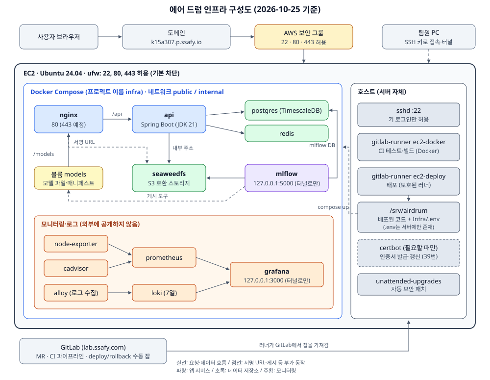

# 포팅 매뉴얼과 인프라 구성

서비스를 새 서버에서 다시 구축하기 위한 문서다. 구성은 `Infra/docker-compose.yml`이 기준이며, 이 문서와 다르면 코드가 맞다.

> **작성 상태 (2026-10-25 초안)**
> - 서버 최초 준비·배포·환경변수는 실제 구성 기준으로 썼다.
> - **백업·복구 절차는 서버 시험 전이다.** 시험 후 상태 표시를 "확인함"으로 바꾼다(6절).
> - HTTPS는 S15P31A307-39가 진행 중이라 현재 계획만 적었다(5절).
> - Ansible(S15P31A307-36)은 아직 없다(7절).
> - "다른 팀원이 문서만 보고 따라 해서 재현" 검증은 하지 않았다.
> - 서버 사양(인스턴스 종류, 디스크 크기)은 확인해서 2절에 채워야 한다.

## 1. 아키텍처



- 인터넷에서 닿는 입구는 **Nginx 하나**(80, HTTPS 후 443)다. API와 스토리지 서명 URL 요청, 모델 파일을 Nginx가 받아 전달한다.
- DB·Redis·스토리지·모니터링은 포트를 공개하지 않고 내부 네트워크(`internal`)에만 둔다.
- Grafana(3000)와 MLflow(5000)는 서버의 `127.0.0.1`에만 열려 있고 SSH 터널로 접속한다(`Infra/ACCESS.md`).
- 배포는 GitLab의 수동 `deploy` 잡이 서버 안의 배포 러너로 실행한다. 서버 접속 키가 CI에 없다.

### 기술 스택

| 영역 | 구성 | 버전 |
| --- | --- | --- |
| 서버 | AWS EC2, Ubuntu 24.04 | 인스턴스 종류·디스크 크기는 확인해 기록 |
| 컨테이너 | Docker, Docker Compose | 서버에서 `docker --version`으로 확인해 기록 |
| 웹 서버 | Nginx | 1.27-alpine |
| 앱 | Spring Boot (JDK 21) | `BE/Dockerfile`로 서버에서 직접 빌드 |
| DB | PostgreSQL + TimescaleDB | timescale/timescaledb 2.30.2-pg16 |
| 캐시 | Redis | 7-alpine |
| 오브젝트 스토리지 | SeaweedFS (S3 호환) | 4.48 |
| 모델 관리 | MLflow | `Infra/mlflow/Dockerfile` 참고 |
| 모니터링·로그 | Prometheus, node-exporter, cAdvisor, Loki, Alloy, Grafana | 각각 `docker-compose.yml`에 고정 |
| 인증서 | certbot (Let's Encrypt) | v5.8.0 (39번 진행 중) |
| CI/CD | GitLab Runner 2개(`ec2-docker`, `ec2-deploy`) | |

아직 이 구성에 들어 있지 않은 것: FE 정적 파일 서빙, AI 서비스(FastAPI) 컨테이너, EMB. 추가되면 이 절과 구성도를 고친다.

## 2. 서버 구성

### 컨테이너 (프로젝트 이름 `infra`)

| 서비스 | 역할 | 호스트 공개 | 메모리 한도 |
| --- | --- | --- | --- |
| nginx | 유일한 외부 입구, 리버스 프록시 | 80 (모든 곳) | 64m |
| api | Spring 앱 | 없음 | 768m |
| postgres | 앱 DB (+ MLflow DB) | 없음 | 1g |
| redis | 캐시·세션 | 없음 | 128m |
| seaweedfs | S3 호환 스토리지 | 없음 | 1g |
| seaweedfs-init | 버킷·만료 정책 생성(일회성) | 없음 | 256m |
| mlflow-db-init | MLflow용 DB 생성(일회성) | 없음 | 128m |
| mlflow | 실험 기록, 모델 레지스트리 | 127.0.0.1:5000 | 1g |
| prometheus | 지표 저장(15일 또는 5GB) | 없음 | 512m |
| node-exporter, cadvisor | 서버·컨테이너 지표 | 없음 | 64m, 256m |
| loki | 로그 저장(7일) | 없음 | 512m |
| alloy | 컨테이너 로그 수집, 민감정보 가림 | 없음 | 256m |
| grafana | 지표·로그 화면 | 127.0.0.1:3000 | 384m |
| certbot | 인증서 발급·갱신 도구(`--profile tools`로만 실행) | 없음 | — |

- 네트워크: `public`(외부 접속 가능), `internal`(외부 접속 없음). DB·Redis·스토리지는 `internal`에만 둔다.
- 모든 서비스가 `restart: unless-stopped`라 서버를 재부팅해도 자동으로 올라온다(재부팅 시험 확인함).
- 컨테이너 로그는 서비스마다 10MB×3개로 제한한다.

### 볼륨 (Compose가 `infra_` 접두사를 붙인다)

| 볼륨 | 내용 | 잃으면 |
| --- | --- | --- |
| `infra_pgdata` | PostgreSQL 데이터 | **서비스 데이터 전체 손실** |
| `infra_redisdata` | Redis 데이터 | 캐시·세션 손실(재생성 가능) |
| `infra_seaweeddata` | 업로드된 악보·음원 등 | **파일 손실** |
| `infra_models` | 게시된 모델 파일·매니페스트 | MLflow에서 다시 게시하면 복구 |
| `infra_letsencrypt` | 인증서와 개인 키 (39번) | 재발급(횟수 제한 주의) |
| `infra_certbot-www` | 인증서 발급 임시 파일 | 영향 없음 |
| `infra_prometheus-data`, `infra_loki-data`, `infra_grafana-data`, `infra_alloy-data` | 관측 데이터 | 과거 지표·로그 손실(앱 기능 영향 없음) |

### 서버 최초 준비 (한 번만)

서버 접속은 `Infra/ACCESS.md`를 따른다. 아래는 비어 있는 새 Ubuntu 서버 기준이다.

1. **패키지와 Docker 설치.** Docker 공식 문서의 Ubuntu 설치 절차(apt 저장소 추가, `docker-ce`, `docker-compose-plugin`)를 따른다. 설치 후 `sudo systemctl enable --now docker`로 부팅 시 자동 시작을 켠다. 복사 도구도 설치한다.
   ```
   sudo apt-get install -y rsync
   ```
2. **방화벽(ufw).** SSH를 먼저 허용한 뒤에 켠다. 순서가 바뀌면 서버에 접속할 수 없다.
   ```
   sudo ufw allow 22/tcp
   sudo ufw allow 80/tcp
   sudo ufw allow 443/tcp
   sudo ufw enable
   ```
   - 클라우드의 보안 그룹에서도 22, 80, 443을 허용해야 한다(AWS 콘솔 권한 필요).
   - Docker가 `ports:`로 공개한 포트는 ufw를 거치지 않는다. 그래서 DB·Redis는 `ports:`를 쓰지 않는다(`Infra/SECURITY.md` 2절).
3. **SSH 설정.** 비밀번호 로그인을 끈다(`PasswordAuthentication no`). 바꾸기 전에 SSH 창을 하나 더 열어 둔다(`Infra/ACCESS.md` 5절).
4. **배포 폴더와 서버 설정 파일.** 배포 절차(3절)의 "서버 최초 준비"를 따른다.
5. **CI 러너 2개.** `ec2-docker`(CI용)는 `Infra/README.md`의 CI 러너 절, `ec2-deploy`(배포용)는 `Infra/deploy/README.md`의 서버 최초 준비를 따른다. 러너 토큰은 서버 터미널에만 입력한다.
6. **자동 보안 업데이트.** Ubuntu 기본 설정(`unattended-upgrades`)이 켜져 있는지 확인한다. 커널·libc 패치는 재부팅해야 적용되므로 주 1회 `ls /var/run/reboot-required`로 확인한다.

## 3. 환경변수와 시크릿

서버의 `/srv/airdrum/Infra/.env` 한 파일에서 관리한다. 저장소에는 값 없이 이름과 설명만 있는 `Infra/.env.example`이 있다. **이 문서와 저장소에 값은 적지 않는다.**

| 변수 | 용도 | 만드는 법·주의 |
| --- | --- | --- |
| `POSTGRES_USER`, `POSTGRES_DB` | DB 계정·DB 이름 | 예시 값 사용 가능. 바꾸면 기존 볼륨과 맞지 않는다 |
| `POSTGRES_PASSWORD` | DB 비밀번호 | **DB를 처음 만들 때 고정된다.** 나중에 바꾸려면 DB 안에서 바꾼다 |
| `REDIS_PASSWORD` | Redis 비밀번호 | `openssl rand -hex 24` |
| `JWT_SECRET` | 로그인 토큰 서명 키 | `openssl rand -base64 48`. **배포마다 바꾸지 않는다**(바꾸면 모든 로그인 토큰이 무효) |
| `FRONTEND_BASE_URL`, `OAUTH_REDIRECT_BASE_URL` | 서비스 주소, 소셜 로그인 콜백 기준 주소 | HTTPS 적용 후 `https://`로 바꾼다. 제공자 콘솔에도 같은 콜백 주소를 등록한다 |
| `GOOGLE_CLIENT_ID/SECRET`, `SSAFY_CLIENT_ID/SECRET` | 소셜 로그인 | 각 제공자 콘솔에서 발급 |
| `ADMIN_EMAILS` | 관리자 이메일(쉼표 구분) | |
| `OBJECT_STORAGE_READ_ACCESS_KEY`, `..._READ_SECRET_KEY` | 스토리지 읽기용 키 | 서버에서 직접 생성: 접근 키 `openssl rand -hex 10`, 비밀 키 `openssl rand -hex 24` |
| `OBJECT_STORAGE_WRITE_ACCESS_KEY`, `..._WRITE_SECRET_KEY` | 스토리지 쓰기용 키 | 위와 같다. 읽기용과 다른 값 |
| `OBJECT_STORAGE_PUBLIC_URL` | 브라우저가 서명 URL로 접속하는 공개 주소 | 도메인 루트, 경로 접두사 없음. HTTPS 후 `https://` |
| `CHART_ASSET_ENABLED`, `PLAY_RAW_ENABLED` | 앱의 스토리지 사용 스위치 | 서버 확인과 BE 확인 후 `true` |
| `GRAFANA_ADMIN_PASSWORD` | Grafana 관리자 비밀번호 | `openssl rand -hex 16`, 비어 있으면 Compose가 실행을 멈춘다 |

규칙(자세한 내용은 `Infra/ACCESS.md` 4절):
- 비밀값은 서버에서 직접 만들어 `.env`에 쓴다. 화면·채팅에 출력하지 않고, 확인은 변수 **이름**이나 **개수**로 한다.
- 필수 변수가 비어 있으면 Compose가 실행을 멈춘다(의도된 동작). `docker compose down`도 멈추므로 변수를 먼저 채운다.
- `.env` 권한은 600이다. 서버 배포는 `.env`를 덮어쓰거나 지우지 않는다.
- `.env` 사본은 백업(6절)과 **다른 곳**에 보관한다. 둘이 같은 곳에 있으면 한 번에 노출된다.

## 4. 배포와 롤백

`Infra/deploy/README.md`가 상세 절차다. 요약:

1. 코드는 `feat/*` → `develop-*` → (금요일 `[DEPLOY]` MR) → `main` 순으로 간다.
2. `main` 파이프라인에서 CI가 통과하면 `deploy` 잡을 **사람이 직접 실행**한다.
3. 러너가 `Infra/deploy/deploy.sh`로 `/srv/airdrum`에 복사하고 `docker compose -p infra up -d --build`, Nginx 설정 reload, 헬스체크(최대 300초)를 한다. 성공하면 `.deployed`에 커밋을 기록한다.
4. 문제가 있으면 `rollback` 잡으로 이전 커밋을 다시 배포한다. **DB 마이그레이션은 되돌리지 않는다.**
5. 이미지 레지스트리가 없어 서버에서 직접 빌드한다(3~5분).

수동(비상) 배포: 서버에서 `Infra/deploy/deploy.sh <커밋> <소스 폴더>`를 러너 사용자로 실행한다. `DRY_RUN=1`을 붙이면 순서만 확인한다.

서비스가 정상인지 확인하는 방법:
```
curl -s -o /dev/null -w "%{http_code}\n" http://localhost/health   # 서버 안에서, 200이면 Nginx 정상
docker compose -p infra ps                                          # 컨테이너 상태(healthy 확인)
```

## 5. 도메인과 HTTPS (S15P31A307-130, 2026-10-27 적용)

- 도메인 `k15a307.p.ssafy.io`가 서버 공개 IP를 가리킨다. **https://k15a307.p.ssafy.io** 로 접속한다. `http://`는 `301`로 https에 보낸다.
- 구성: Nginx가 80번(인증서 갱신 경로와 `/health`만 처리, 나머지는 https로 리다이렉트)과 443번(실제 서비스, TLS 1.2·1.3, HTTP/2)을 듣는다. 인증서·개인 키는 `letsencrypt` 볼륨에 있고 Nginx에는 읽기 전용으로 연결한다. `certbot`은 평소에는 실행하지 않고(`profiles: ["tools"]`) 필요할 때만 쓴다.
- **중요한 순서:** 443 설정은 인증서 파일을 가리킨다. 인증서가 없는 상태에서 배포하면 Nginx가 시작하지 못해 서비스 전체가 내려간다. **인증서를 먼저 발급하고 443 설정을 배포한다.**

### 인증서 최초 발급 (서버에서 `/srv/airdrum/Infra`, 명령은 `sudo`가 필요하다)

1. 사전 점검 – Let's Encrypt가 접근하는 것과 같은 경로가 바깥에서 열리는지 본다. `ok`가 나와야 한다.
   ```bash
   sudo docker compose -p infra run --rm --entrypoint sh certbot -c 'mkdir -p /var/www/certbot/.well-known/acme-challenge && echo ok > /var/www/certbot/.well-known/acme-challenge/test'
   curl -s http://k15a307.p.ssafy.io/.well-known/acme-challenge/test
   sudo docker compose -p infra run --rm --entrypoint sh certbot -c 'rm -f /var/www/certbot/.well-known/acme-challenge/test'
   ```
2. 스테이징(시험용) 발급 – 발급 횟수 제한에 영향이 없다. `Successfully received certificate`가 나와야 한다.
   ```bash
   sudo docker compose -p infra run --rm certbot certonly --webroot -w /var/www/certbot -d k15a307.p.ssafy.io --staging --agree-tos --email <이메일> --no-eff-email
   ```
3. 진짜 발급 – 같은 이름의 스테이징 인증서를 `--force-renewal`로 교체한다. 진짜 발급 횟수 제한이 적용되므로 한 번만 한다.
   ```bash
   sudo docker compose -p infra run --rm certbot certonly --webroot -w /var/www/certbot -d k15a307.p.ssafy.io --force-renewal --agree-tos --email <이메일> --no-eff-email
   ```
4. 발급자와 만료일 확인 – 발급자에 `(STAGING)`이 없어야 진짜 인증서다.
   ```bash
   sudo docker compose -p infra run --rm --entrypoint sh certbot -c "openssl x509 -in /etc/letsencrypt/live/k15a307.p.ssafy.io/fullchain.pem -noout -issuer -enddate"
   ```
5. 새 Nginx 설정을 배포 전에 임시 컨테이너로 시험한다(운영 Nginx는 건드리지 않는다). `test is successful`이 나와야 한다.
   ```bash
   docker run --rm -v <default.conf 경로>:/etc/nginx/conf.d/default.conf:ro -v infra_letsencrypt:/etc/letsencrypt:ro -v infra_models:/usr/share/nginx/models:ro nginx:1.27-alpine nginx -t
   ```

### 현재 상태 (2026-10-27)
- 진짜 인증서 발급 완료. 발급자 Let's Encrypt(`YE2`), **만료 2027-01-25**.
- 갱신 시험 `certbot renew --dry-run`이 성공했다(`all simulated renewals succeeded`).
- **자동 갱신은 구성하지 않았다.** 프로젝트가 만료일 이전에 끝나므로 수동 갱신으로 대체하기로 했다(결정 2026-10-27). 서버를 만료일 이후에도 쓰게 되면 아래 수동 갱신을 한다.

### 수동 갱신 (만료 30일 전부터 가능)
`renew`는 만료까지 30일 넘게 남았으면 갱신하지 않는다. 2026-12-26 이후에 실행한다.
```bash
cd /srv/airdrum/Infra
sudo docker compose -p infra run --rm certbot renew
sudo docker compose -p infra exec -T nginx nginx -s reload
```
두 번째 줄을 빼면 Nginx가 옛 인증서를 계속 쓴다. 갱신 뒤 위 4번 명령으로 만료일이 바뀌었는지 확인한다.

### 앱 주소 (서버 `.env`)
`FRONTEND_BASE_URL`, `OAUTH_REDIRECT_BASE_URL`, `OBJECT_STORAGE_PUBLIC_URL`을 모두 `https://k15a307.p.ssafy.io`로 둔다(2026-10-27 서버 `.env` 변경, 배포 때 `api`·`seaweedfs`가 새 값으로 다시 시작). 소셜 로그인 제공자 콘솔(Google, SSAFY)에도 콜백 주소 `https://k15a307.p.ssafy.io/api/auth/{google|ssafy}/callback`을 등록해야 한다(BE 담당).

### 남은 것
HSTS 적용 시점 결정, 외부 검증(SSL Labs, 폰·다른 브라우저 접속), 로그인 동작 확인(콜백 등록 후).

## 6. 백업과 복구 (최소 절차, 2026-10-30 서버 시험함)

> 앱 DB·MLflow DB·SeaweedFS 볼륨을 서버에서 백업하고 **별도의 시험용 DB·볼륨에 복원**해 확인했다(S15P31A307-133). 시험 결과와 한계는 아래 "서버 시험 결과"에 있다. 명령은 `/srv/airdrum/Infra`에서 `sudo`로 실행한다.

### 무엇을 백업하나

| 대상 | 백업 | 이유 |
| --- | --- | --- |
| PostgreSQL (앱 DB, MLflow DB) | **필수** | 서비스 데이터 |
| SeaweedFS 볼륨 | **필수** | 업로드된 악보·음원·MLflow 아티팩트 |
| `.env` | **필수**(다른 곳에 따로) | 없으면 서비스를 다시 올릴 수 없다 |
| `infra_letsencrypt` | 권장 | 재발급은 가능하지만 횟수 제한이 있다. 개인 키가 들어 있다 |
| `infra_models` | 선택 | MLflow에서 다시 게시할 수 있다 |
| Prometheus·Loki·Grafana 볼륨 | 안 함 | 관측 데이터는 재생성 가능. 대시보드·알림은 코드(`Infra/monitoring/`)에 있다 |
| Redis | 안 함 | 캐시 |

### 원칙
- **백업을 서버 안에만 두지 않는다.** 서버가 사라지면 같이 사라진다. 서버 밖(담당자 PC나 별도 저장소)에 복사한다.
- 백업 파일에는 개인정보·개인 키가 들어 있다. 저장소에 올리지 않고 접근을 제한한다(`chmod 600`).
- 백업은 **복원해 봐야** 백업이다. 새 서버나 시험 환경에서 복원을 시험한다.
- 보관: 앱 DB·MLflow DB·SeaweedFS 백업은 **30일**만 둔다. 아래 "보관 기간과 삭제"를 따른다.

### PostgreSQL

백업(서버에서, 컨테이너가 실행 중일 때):
```
cd /srv/airdrum/Infra
sudo mkdir -p /srv/airdrum/backup && sudo chmod 700 /srv/airdrum/backup
sudo touch /srv/airdrum/backup/app_$(date +%F).dump && sudo chmod 600 /srv/airdrum/backup/app_$(date +%F).dump
sudo docker compose -p infra exec -T postgres sh -c 'pg_dump -U "$POSTGRES_USER" -d "$POSTGRES_DB" -Fc' | sudo tee /srv/airdrum/backup/app_$(date +%F).dump > /dev/null
sudo touch /srv/airdrum/backup/mlflow_$(date +%F).dump && sudo chmod 600 /srv/airdrum/backup/mlflow_$(date +%F).dump
sudo docker compose -p infra exec -T postgres sh -c 'pg_dump -U "$POSTGRES_USER" -d mlflow -Fc' | sudo tee /srv/airdrum/backup/mlflow_$(date +%F).dump > /dev/null
```
- `-Fc`는 복원 도구(`pg_restore`)가 쓰는 압축 형식이다. 컨테이너 안의 환경변수(`POSTGRES_USER`)를 쓰므로 비밀번호를 명령에 쓰지 않는다.
- 파일을 먼저 `touch`로 만들고 `chmod 600`한 뒤 내용을 쓴다. 쓴 뒤에 권한을 바꾸면 그 사이에 다른 사용자가 읽을 수 있다.
- 앱 DB의 `pg_dump`는 `continuous_agg` 테이블의 순환 외래키 경고(`circular foreign-key constraints`)를 낸다. TimescaleDB 내부 카탈로그에서 나오는 것으로 백업은 정상이다. 경고를 보려면 `2>/dev/null`을 빼고 실행한다.
- 백업이 읽히는지는 `sudo cat <파일> | sudo docker compose -p infra exec -T postgres pg_restore -l | head`로 확인한다(목록이 나오면 읽히는 것).

복원(**비어 있는 DB**에 한다. 운영 DB에 바로 복원하지 않는다):
```
cd /srv/airdrum/Infra
# 1. 빈 DB를 만든다. 새 DB는 template1을 복사하므로 timescaledb 확장이 이미 들어 있다.
sudo docker compose -p infra exec -T postgres sh -c 'psql -U "$POSTGRES_USER" -d postgres -c "CREATE DATABASE restore_test"'
sudo docker compose -p infra exec -T postgres sh -c 'psql -U "$POSTGRES_USER" -d restore_test -c "CREATE EXTENSION IF NOT EXISTS timescaledb"'
# 2. TimescaleDB는 복원 전후에 확장 전용 함수를 호출해야 한다.
sudo docker compose -p infra exec -T postgres sh -c 'psql -U "$POSTGRES_USER" -d restore_test -c "SELECT timescaledb_pre_restore()"'
sudo cat /srv/airdrum/backup/app_<날짜>.dump | sudo docker compose -p infra exec -T postgres sh -c 'pg_restore -U "$POSTGRES_USER" -d restore_test --no-owner' 2>&1 | tail -20
sudo docker compose -p infra exec -T postgres sh -c 'psql -U "$POSTGRES_USER" -d restore_test -c "SELECT timescaledb_post_restore()"'
```
- `-d` 뒤의 DB 이름을 틀리지 않는다. 운영 DB 이름을 쓰면 운영 DB에 복원이 시도된다.
- MLflow DB는 TimescaleDB를 쓰지 않아 `pre_restore`/`post_restore` 없이 `pg_restore`만 한다.
- 시험이 끝나면 시험용 DB를 지운다(`DROP DATABASE restore_test`).
- 복원 결과 확인은 아래 "서버 시험 결과"의 비교 쿼리를 쓴다.
- 앱이 Flyway로 스키마를 만든다. 복원한 DB의 `flyway_schema_history`가 원본과 같으면(행 수와 마지막 순번) 앱이 마이그레이션을 이미 적용된 것으로 인식한다. 앱을 복원본에 실제로 붙여 본 것은 아니다.

### SeaweedFS 볼륨

일관성을 위해 쓰기를 멈추고 복사한다(앱이 잠깐 스토리지에 접근하지 못한다).
```
cd /srv/airdrum/Infra
sudo docker compose -p infra stop seaweedfs
sudo docker run --rm -v infra_seaweeddata:/data:ro -v /srv/airdrum/backup:/backup alpine \
  tar czf /backup/seaweed_$(date +%F).tgz -C /data .
sudo docker compose -p infra start seaweedfs
sudo chmod 600 /srv/airdrum/backup/seaweed_*.tgz
```
- 볼륨 이름(`infra_seaweeddata`)은 `docker volume ls`로 확인한다. 멈추는 데 약 10초 걸렸다. 그동안 악보·음원 접근이 안 된다.
- 복원은 새 서버에서 볼륨을 만들고 같은 방식으로 `tar xzf`로 푼 뒤 `seaweedfs`를 시작한다. 시험은 임시 볼륨(`restore_test_seaweed`)에 풀어 파일 목록을 비교했다. 임시 볼륨은 이름을 확인한 뒤 `docker volume rm`으로 지운다.

### 인증서 볼륨 (39번 이후)
```
docker run --rm -v infra_letsencrypt:/data:ro -v ~/backup:/backup alpine \
  tar czf /backup/letsencrypt_$(date +%F).tgz -C /data .
chmod 600 ~/backup/letsencrypt_*.tgz
```
- 개인 키가 들어 있다. 반드시 서버 밖의 안전한 곳에 보관하고 저장소·채팅에 올리지 않는다.

### 서버 시험 결과 (2026-10-30, S15P31A307-133)

| 대상 | 방법 | 결과 |
| --- | --- | --- |
| 앱 DB (`app`) | 새 백업 → 빈 `restore_test`에 `pre_restore` → `pg_restore` → `post_restore` | 복원 오류 없음. 테이블 19개 행 수가 원본과 모두 같음. `flyway_schema_history` 18행, 마지막 순번 18로 같음 |
| MLflow DB (`mlflow`) | 새 백업 → 빈 `restore_test_mlflow`에 `pg_restore` | 복원 오류 없음. 테이블별 행 수 해시가 원본과 같음 |
| SeaweedFS 볼륨 | `seaweedfs` 정지 → `tar` → 시작 → 임시 볼륨에 풀어 비교 | 용량 같음(328K). 파일 목록 차이는 `filerldb2`(메타데이터 LevelDB)의 로그·매니페스트 파일 이름뿐이며 재시작 때 교체된 것으로 사용자 데이터 파일 차이는 없음 |

행 수 비교 쿼리(두 DB에서 같은 쿼리를 실행해 결과를 비교한다):
```
SELECT table_name, (xpath('/row/c/text()', query_to_xml(format('select count(*) as c from %I.%I', table_schema, table_name), false, true, '')))[1]::text AS n FROM information_schema.tables WHERE table_schema='public' AND table_type='BASE TABLE' ORDER BY 1;
```

한계(시험하지 못한 것)
- `telemetry_events`(hypertable)에 데이터가 없어 청크(`num_chunks = 0`)가 든 상태의 복원은 시험하지 못했다. 데이터가 쌓이면 다시 시험한다.
- 복원한 DB·볼륨에 서비스를 실제로 붙여 기동해 보지 않았다. 행 수·이력·파일 목록 비교까지만 했다.
- SeaweedFS에는 지금 파일이 거의 없다(328K). 데이터가 쌓였을 때의 백업 시간과 정지 시간은 모른다.
- **서버 밖 보관은 하지 않았다.** 백업은 서버의 `/srv/airdrum/`(루트 소유, 권한 600/700)에만 있어서 서버가 사라지면 같이 사라진다. 보관 위치와 접근 제한(6절 "원칙")은 정하지 못했다. 자동화와 주기도 정하지 않았다(범위 밖).

### 보관 기간과 삭제

백업에는 탈퇴·철회로 지운 개인정보가 남아 있다. 그래서 디스크가 아니라 보관 기간을 기준으로 지운다. 탈퇴·철회로 지운 정보는 백업이 만료될 때까지 최대 30일 남는다.

| 대상 | 보관 |
| --- | --- |
| 앱 DB, MLflow DB, SeaweedFS 백업 | 30일. 서버 안과 서버 밖 사본 모두 같다 |
| `.env`, 인증서 사본 | 개인정보 백업이 아니라서 이 규칙을 적용하지 않는다 |

서버에서 지울 때(이름을 꼭 지정한다. `.env`와 인증서 사본을 함께 지우지 않게):

```bash
sudo find /srv/airdrum/backup -type f \( -name 'app_*.dump' -o -name 'mlflow_*.dump' -o -name 'seaweed_*.tgz' \) -mtime +30 -print -delete
```

- 서버 밖 사본은 자동으로 지워지지 않는다. 보관하는 사람이 같은 기준으로 지운다.
- 실제로 지우기 전에 `-delete`를 빼고 목록부터 확인한다.
- 지운 날짜와 파일 이름을 기록한다.

### 복원 뒤 재처리

**복원하면 백업 시점 이후의 탈퇴와 철회가 사라진다.** 지운 정보가 되살아나고 회원이 `ACTIVE`로 돌아온다. 복원한 채로 서비스를 열면 안 된다.

| 되살아나는 것 | 처리 |
| --- | --- |
| 백업 이후 탈퇴한 회원 | 탈퇴를 다시 적용한다. `WithdrawnPlayCleanup`은 `WITHDRAWN` 회원만 보므로 저절로 지워지지 않는다 |
| 백업 이후 철회한 동의 | 철회를 다시 적용한다 |
| 백업 시점에 이미 탈퇴한 회원의 세션 | `WithdrawnPlayCleanup`이 1분 주기로 다시 지운다 |
| 만료 후보, 만료 동의 이력 | 보관 기간 작업이 다시 지운다 |

순서:

1. **복원 전에**, 현재 DB에 접속할 수 있으면 백업 시각 이후의 목록을 뽑아 서버 밖에 임시로 둔다. 재처리가 끝나면 지운다.

   ```sql
   SELECT id FROM users WHERE status = 'WITHDRAWN' AND withdrawn_at > '<백업 시각>';
   SELECT user_id FROM user_recommendation_consent WHERE NOT agreed AND updated_at > '<백업 시각>';
   ```

2. 외부 접속을 막은 채로 복원한다.
3. 목록의 철회와 탈퇴를 다시 적용한다.
4. 목록의 회원이 뷰와 `recommendation_candidates`에 없는지 확인한 뒤 서비스를 연다.

**한계:**

- 현재 DB에 접속할 수 없으면(서버 유실) 목록을 뽑을 수 없다. 탈퇴는 `회원 탈퇴 userId=` 로그로 찾을 수 있지만 Loki는 7일만 보관하고 백업하지 않는다. 철회는 로그가 없다. 이때는 백업 이후 탈퇴·철회를 찾을 방법이 없어, 복구 뒤 사용자에게 알려야 한다.
- 탈퇴 재적용 도구는 아직 없다. 탈퇴는 소셜 연동, 프리셋, 녹음, 텔레메트리, 곡 정리까지 함께 하므로 SQL로 일부만 고치면 안 된다. 복원이 필요해지면 `WithdrawalService`를 호출하는 관리 작업을 먼저 만든다.
- 이 절차는 서버에서 시험하지 않았다.

### 새 서버에 전체 복구하는 순서
1. 2절 "서버 최초 준비"를 한다(Docker, ufw, 러너).
2. 보관해 둔 `.env`를 `/srv/airdrum/Infra/.env`에 놓는다(권한 600). **DB 비밀번호가 바뀌면 복원한 DB에 접속하지 못한다.**
3. `main`을 배포한다(4절). 앱이 빈 DB로 한 번 시작할 수 있다.
4. 앱을 멈추고(`stop api`) DB를 복원한다. "복원 뒤 재처리"를 마친 뒤 앱을 연다.
5. SeaweedFS 볼륨을 복원하고 `seaweedfs`를 시작한다.
6. (39번 이후) 인증서 볼륨을 복원하거나 새로 발급한다.
7. `/health`, 로그인, 악보 불러오기를 확인한다.

### 주의
- 서버에서 `docker volume prune`, `docker system prune --volumes`를 실행하지 않는다. 멈춘 서비스의 볼륨이 삭제된다.
- 볼륨을 지우는 명령(`docker compose down -v`)은 시험 환경에서만 쓴다.
- 자동화(cron 등)는 시험이 끝난 뒤에 한다. 지금은 수동 절차다.

## 7. Ansible (S15P31A307-36, 미작성)

아직 플레이북이 없다. 2절의 "서버 최초 준비"와 3~4절이 플레이북이 될 작업 목록이다.

| 작업 | 위치 |
| --- | --- |
| Docker 설치, `rsync` 설치 | 2절 1번 |
| ufw 규칙, SSH 설정(`PasswordAuthentication no` 등) | 2절 2~3번 |
| `/srv/airdrum` 생성, 러너 사용자 소유 | 배포 README |
| `gitlab-runner` 설치·등록(토큰은 변수로 받고 저장소에 두지 않는다) | `Infra/README.md`, `Infra/deploy/README.md` |
| `gitlab-runner`를 docker 그룹에 추가 | 배포 README |
| `unattended-upgrades` 설정 | 2절 6번 |

플레이북이 생기면 실행 방법(인벤토리, 변수, 명령)을 이 절에 적는다. 비밀값은 Ansible Vault나 서버 입력으로 다루고 저장소에 평문으로 두지 않는다.

## 8. 운영 점검

| 주기 | 점검 |
| --- | --- |
| 배포 후 | `/health` 200, `docker compose -p infra ps`의 healthy |
| 주 1회 | `ls /var/run/reboot-required`(있으면 CI·배포가 없을 때 재부팅), 디스크 사용량(`df -h`) |
| 필요할 때 | 접속 기록(`last`, `journalctl -u ssh`), 열린 포트(`sudo ss -tlnp`) |

관련 문서: [서버 접속 가이드](./ACCESS.md), [보안 점검 기록](./SECURITY.md), [트러블슈팅](./TROUBLESHOOTING.md), [배포](./deploy/README.md)
