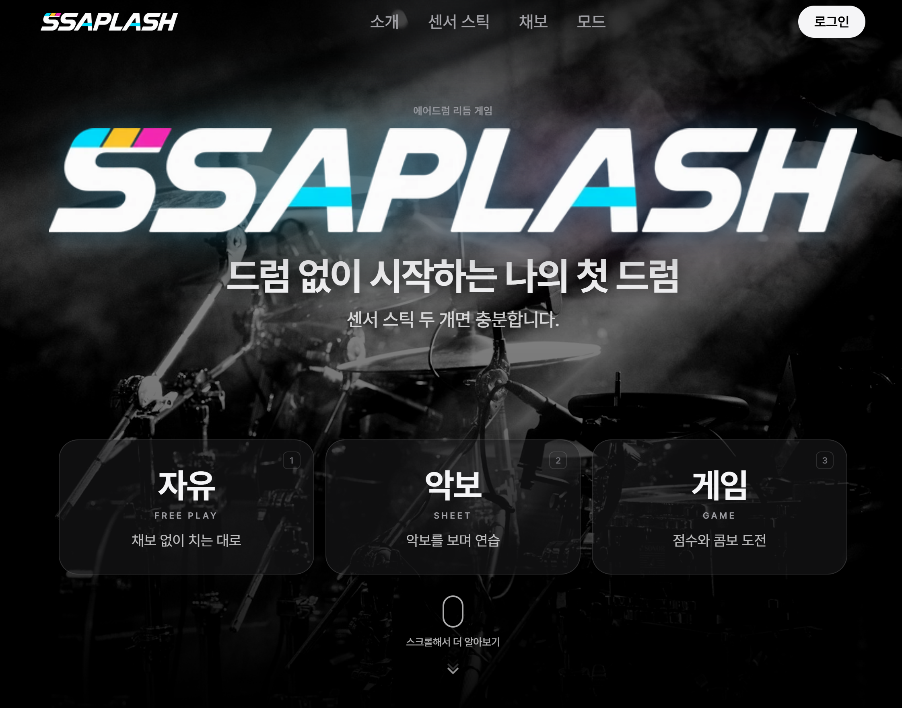
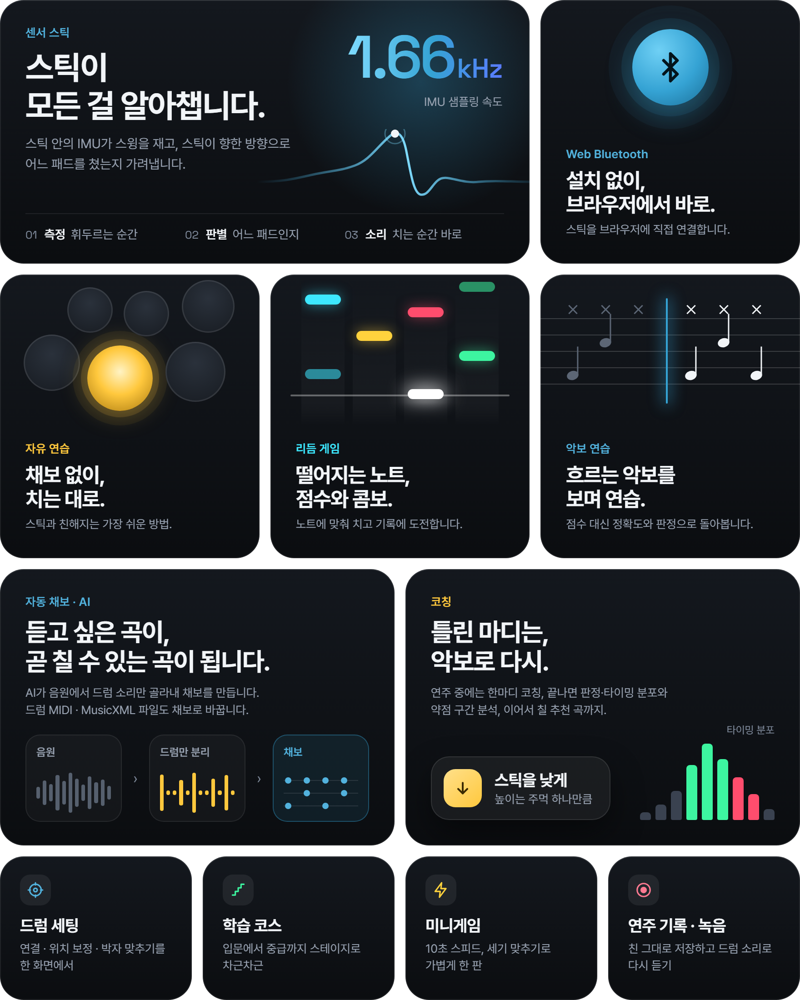
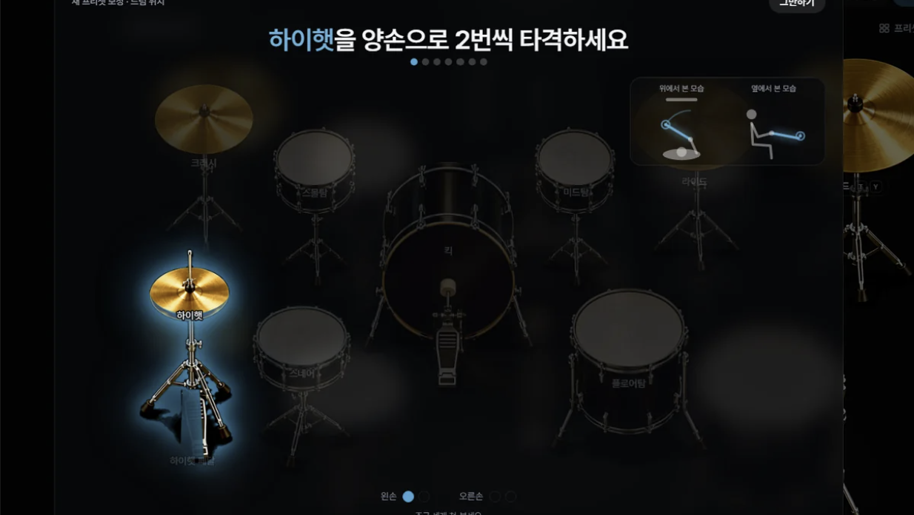
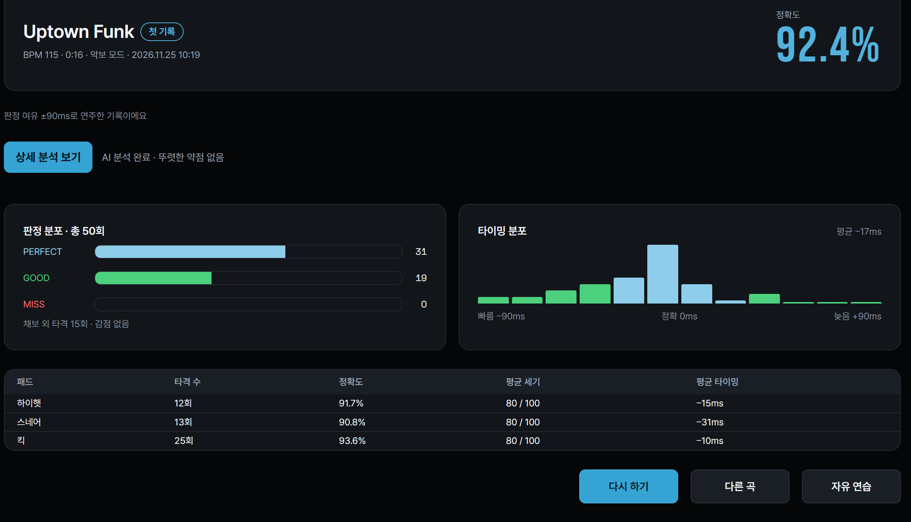
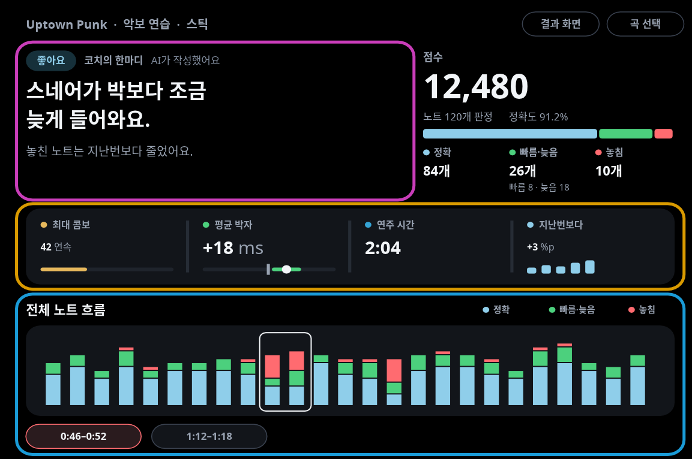
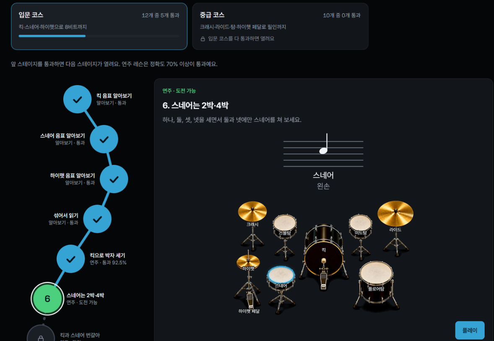
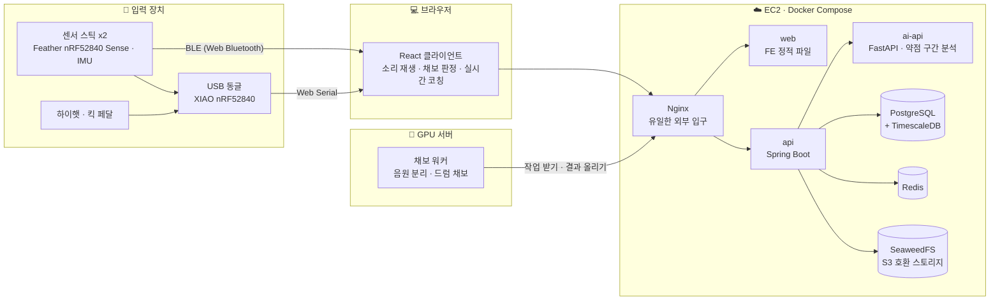

<div align="center">

# 🥁 싸플래쉬 · SSAPLASH

### 드럼 없이 시작하는 나의 첫 드럼

**IMU 센서 스틱** 두 개로 허공을 치면 드럼 소리가 나고,<br/>
AI가 만든 **채보**를 따라 연주하며 **코칭**으로 실력을 쌓는 웹 기반 에어드럼 서비스

<br/>


<br/>


<br/>

**SSAFY 15기 자율 프로젝트** &nbsp;|&nbsp; 2026.10 – [확인필요]

[🌐 서비스](https://k15a307.p.ssafy.io) · 🎬 시연 영상 [링크 예정] · 🎨 Figma [링크 예정] · 📊 발표 자료 [링크 예정] · 📝 Notion [링크 예정]

<br/>



</div>

---

## 📑 목차

1. [프로젝트 소개](#-프로젝트-소개)
2. [주요 기능](#-주요-기능)
3. [화면](#-화면)
4. [시스템 아키텍처](#-시스템-아키텍처)
5. [기술 스택](#-기술-스택)
6. [폴더 구조](#-폴더-구조)
7. [시작하기](#-시작하기)
8. [팀](#-팀)
9. [문서](#-문서)

---

## 💡 프로젝트 소개

> **"드럼이 없어도, 드럼을 칠 수 있다면."**<br/>
> 가격 · 공간 · 소음 때문에 시작하지 못했던 드럼을 **스틱 두 개와 브라우저만으로** 시작하게 해 주는 서비스입니다.

**싸플래쉬**는 IMU 센서가 든 스틱을 휘두르면 스틱이 **언제 · 어느 패드를 · 얼마나 세게** 쳤는지 판정해 브라우저로 보내고, 브라우저가 그 순간 드럼 소리를 냅니다. 치고 싶은 곡의 음원을 올리면 AI가 드럼을 분리해 **채보**를 만들고, 연주가 끝나면 **약점 구간**을 짚어 다음 연습으로 이어 줍니다.

| | |
| :-- | :-- |
| 🎯 **목표** | 드럼 없이도 시작하고, 혼자서도 늘 수 있는 입문 · 반복 연습 환경 |
| 🥢 **입력 장치** | 직접 만든 IMU 센서 스틱 2개 + 하이햇 · 킥 페달 |
| ⚙️ **핵심 기술** | 스틱 펌웨어의 타격 검출 · 패드 판정 · 음원 드럼 분리와 드럼 채보 · 약점 구간 분석 |
| 💻 **형태** | 설치 없는 웹 서비스 (Chrome · Edge, Web Bluetooth) |

### 🎬 시연 영상

[링크 예정]

---

## ✨ 주요 기능



### 🥢 1. 센서 스틱

- 스틱 안의 IMU를 **1.66kHz**로 읽어 타격을 검출하고, 스틱이 향한 방향으로 **어느 패드를 쳤는지** 판정
- **BLE(Web Bluetooth)** 로 브라우저에 직접 연결, USB 동글(Web Serial) 경로도 지원
- 타격 순간 스틱 안에서 바로 울리는 **진동(햅틱)**, 하이햇 · 킥 페달

### 🎛️ 2. 드럼 세팅

- 한 화면에서 **스틱 연결 → 시작 위치 보정 → 박자 맞추기**까지
- 박자 맞추기로 사용자 환경의 **판정 타이밍을 자동 보정**
- 키트 배치 **프리셋** 저장 · 전환

### 🎮 3. 세 가지 연주 모드

- **자유 연습** — 채보 없이 치는 대로 소리가 납니다
- **리듬 게임** — 떨어지는 노트에 맞춰 치고 점수와 콤보를 쌓습니다
- **악보 연습** — 가로로 흐르는 악보를 보며 치고, 점수 대신 정확도와 판정으로 돌아봅니다

### 🤖 4. AI 자동 채보

- 음원을 올리면 **곡인지 먼저 판단**하고, **드럼과 반주(MR)를 분리**한 뒤 드럼 트랙에서 **채보를 생성**
- 분리한 반주는 연주할 때 배경음으로 사용
- 드럼 **MIDI · MusicXML** 파일은 바로 채보로 변환, 드럼 악보(이미지 · PDF)는 라이브러리에 보관

### 🧑‍🏫 5. 코칭

- **실시간 코칭** — 연주 중 판정 흐름에서 경향을 뽑아 "스틱을 낮게"처럼 짧은 구령으로 안내
- **연주 결과** — 점수 · 정확도 · 판정 분포 · 타이밍 분포
- **코치 리포트** — 약점 구간 분석, 약점에 맞춘 연습과 추천 곡

### 📚 6. 학습 코스 · 미니게임 · 녹음

- **학습 코스** — 입문(킥 · 스네어 · 하이햇)에서 중급(크래시 · 라이드 · 탐 · 하이햇 페달)까지 스테이지로 진행
- **미니게임** — 「누구보다 빠르게」(10초 스네어 타수), 「강약중강약」(세기 맞추기)
- **연주 기록 · 녹음** — 타격 시퀀스를 저장해 드럼 소리로 다시 듣기

---

## 📸 화면

사용 흐름 순서입니다. 곡을 준비하고, 연주하고, 결과를 돌아봅니다.

<table>
  <tr>
    <td width="50%" align="center"><br><b>1. 드럼 세팅</b><br>스틱 연결 · 시작 위치 보정 · 박자 맞추기 · 프리셋</td>
    <td width="50%" align="center"><br><b>2. 라이브러리</b><br>음원을 올리면 AI가 채보를 만듭니다</td>
  </tr>
  <tr>
    <td align="center"><br><b>3. 리듬 게임</b><br>떨어지는 노트에 맞춰 치고 점수와 콤보를 쌓습니다</td>
    <td align="center"><br><b>4. 악보 연습</b><br>가로로 흐르는 악보를 보며 정확도와 판정으로 연습합니다</td>
  </tr>
  <tr>
    <td align="center"><br><b>5. 연주 결과</b><br>점수 · 정확도 · 판정 분포 · 타이밍 분포</td>
    <td align="center"><br><b>6. 코치 리포트</b><br>코치 한마디 · 약점 구간 분석 · 추천 곡</td>
  </tr>
</table>

<details>
<summary><b>🖼️ 화면 더 보기</b> — 자유 연습 · 학습 코스 · 미니게임</summary>

<br/>

<table>
  <tr>
    <td width="50%" align="center"><br><b>자유 연습</b><br>채보 없이 치는 대로 소리가 납니다</td>
    <td width="50%" align="center"><br><b>학습 코스</b><br>입문 · 중급 스테이지를 순서대로 통과합니다</td>
  </tr>
  <tr>
    <td align="center"><br><b>미니게임</b><br>혼자 기록을 깨거나 번갈아 겨루는 가벼운 게임</td>
    <td align="center"><br><b>누구보다 빠르게</b><br>10초 동안 스네어를 친 횟수를 겨룹니다</td>
  </tr>
</table>

</details>

---

## 🏗 시스템 아키텍처



### 데이터 흐름 한눈에

| 흐름 | 경로 | 시점 |
| :-- | :-- | :-- |
| **연주** | 스틱(타격 · 패드 · 세기 판정) → BLE → 브라우저(소리 재생 · 채보 판정) | 실시간, 서버를 거치지 않음 |
| **채보 생성** | 음원 업로드 → API → 스토리지 → 채보 워커(분리 · 채보) → API → 라이브러리 | 비동기 작업 |
| **리포트** | 연주 기록 업로드 → API → ai-api(약점 구간 분석) → 코치 리포트 | 연주 종료 후 |

---

## 🛠 기술 스택

| 영역 | 기술 |
| :-- | :-- |
| **Frontend** | React 19 · TypeScript · Vite · Zustand · TanStack Query · ONNX Runtime Web |
| **Backend** | Java 21 · Spring Boot 4.1.1 · Gradle |
| **AI / Data** | Python 3.11 · PyTorch · FastAPI · BS-RoFormer · STRUM · Ollama(gemma3:12b) · MLflow |
| **Embedded** | Arduino(C/C++) · Adafruit Feather nRF52840 Sense · Seeed XIAO nRF52840 · BLE |
| **Infra** | AWS EC2 · Docker Compose · Nginx · PostgreSQL(TimescaleDB) · Redis · SeaweedFS · GitLab CI/CD · Prometheus · Grafana · Loki |

---

## 📁 폴더 구조

```
SSAPLASH/
├─ 🧠 AI/        음원 드럼 분리 · 드럼 채보 · 채보 워커 · 코칭 분석 (Python)
├─ ☕ BE/        API 서버 (Java · Spring Boot)
├─ 🥢 EMB/       센서 스틱 · 페달 · 동글 펌웨어, 하우징 CAD
├─ ⚛️ FE/        웹 클라이언트 (React · TypeScript)
├─ 🐳 Infra/     배포 구성 (Docker Compose · Nginx · 모니터링)
├─ 📦 exec/      포팅 매뉴얼 (빌드·배포 · 외부 서비스 · DB 덤프 · 시연 시나리오)
├─ 📚 Docs/
│  ├─ README.md       상세 문서 안내 (GitLab Wiki)
│  ├─ API/            API 예시
│  └─ images/         README 이미지
└─ 🔧 tools/
   └─ planning-references/   기획 근거 재현 코드 · 집계 원본
```

---

## 🚀 시작하기

> 파트별 상세 셋업은 각 폴더의 README를 참고하세요. 운영 배포 절차는 [`exec/1-빌드-배포-매뉴얼.md`](./exec/1-빌드-배포-매뉴얼.md)에 있습니다.

```bash
# Frontend — http://localhost:5173
cd FE && npm install && npm run dev

# Backend — JDK 21, PostgreSQL 16(TimescaleDB) · Redis 7 필요. 환경 변수는 BE/README.md 참고
cd BE && ./gradlew bootRun

# AI — uv가 Python 3.11과 의존성을 준비
cd AI && uv sync
```

백엔드 없이 화면만 볼 때는 `FE/.env.local`에 아래 두 줄을 두면 로그인 없이 내장 곡으로 열립니다.

```bash
VITE_AUTH_REQUIRED=false
VITE_SONGS_SOURCE=builtin
```

비밀번호 · 토큰 · 키는 저장소에 두지 않습니다. 필요한 값의 이름과 만드는 법은 [`exec/2-외부-서비스.md`](./exec/2-외부-서비스.md)를 참고하세요.

---

## 👥 팀

| 파트 | 담당 | 주요 기여 |
| :-- | :-- | :-- |
| ⚛️ Frontend | [확인필요] | [확인필요] |
| ☕ Backend | [확인필요] | [확인필요] |
| 🧠 AI & Data | [확인필요] | [확인필요] |
| 🥢 Embedded | [확인필요] | [확인필요] |
| 🐳 Infra | [확인필요] | [확인필요] |

---

## 📚 문서

| 파트 | 문서 |
| :-- | :-- |
| 🧠 AI & Data | [AI/README.md](./AI/README.md) |
| ☕ Backend | [BE/README.md](./BE/README.md) |
| 🥢 Embedded | [EMB/README.md](./EMB/README.md) · [스틱 펌웨어](./EMB/stick_fw_nrf52/README.md) |
| ⚛️ Frontend | [FE/README.md](./FE/README.md) |
| 🐳 Infra | [Infra/README.md](./Infra/README.md) · [포팅 매뉴얼](./Infra/PORTING.md) · [인프라 구성도](./Infra/architecture.svg) |
| 📦 제출 | [빌드 · 배포 매뉴얼](./exec/1-빌드-배포-매뉴얼.md) · [외부 서비스](./exec/2-외부-서비스.md) · [DB 덤프](./exec/3-DB-덤프.md) · [시연 시나리오](./exec/4-시연-시나리오.md) |

| 외부 링크 | 주소 | 내용 |
| :-- | :-- | :-- |
| 🎬 시연 영상 | [링크 예정] | 서비스 시연 |
| 🎨 Figma | [링크 예정] | 화면 디자인 · 디자인 시스템 |
| 📊 발표 자료 | [링크 예정] (Canva) | 발표 슬라이드 |
| 📝 Notion | [링크 예정] | [확인필요] 공개할 페이지 범위 |
| 🦊 GitLab | [s15-final/S15P31A307](https://lab.ssafy.com/s15-final/S15P31A307) | 원본 저장소 (SSAFY GitLab 계정 필요) |
| 📋 JIRA | `S15P31A307` [확인필요] 보드 주소 | 이슈 관리 |

<details>
<summary><b>📝 기획 · 설계 문서</b> — GitLab Wiki</summary>

<br/>

상세 기획 · 설계 · 규칙 · 회의록은 [GitLab Wiki](https://lab.ssafy.com/s15-final/S15P31A307/-/wikis/home)에서 관리합니다. (SSAFY GitLab 계정 필요) 주요 문서 바로가기는 [Docs/README.md](./Docs/README.md)에 있고, 저장소에는 기획 근거 재현 도구(`tools/planning-references/`)만 둡니다.

</details>

<details>
<summary><b>🤝 개발 규칙</b> — 브랜치 · 커밋 · MR</summary>

<br/>

[Git 컨벤션 Wiki](https://lab.ssafy.com/s15-final/S15P31A307/-/wikis/3-%EA%B7%9C%EC%B9%99/3-1-Git-%EC%BB%A8%EB%B2%A4%EC%85%98)를 따릅니다.

```
브랜치   feat/{Epic prefix}-{작업 내용}   예) feat/AUTH-login-api
커밋     [{JIRA 키}] {type}: {subject}   예) [S15P31A307-3] docs: 기획 문서 추가
```

- `main`, `develop-*`에는 직접 커밋하지 않고 MR로만 반영합니다
- MR은 리뷰어 1인 이상의 승인을 받아야 병합합니다
- 매주 금요일 정기 릴리즈 — 버전은 `v{주차}.{번호}`

</details>
